# Informe del Proyecto Final — Borrador en migración

**Título canónico del proyecto:** Implementación de un sistema web transaccional con módulos de inteligencia de negocios e inteligencia artificial para la optimización de los procesos operativos y financieros en Impresos Trujillo E.I.R.L.

> **Borrador de trabajo para revisión conjunta.** Organizado según la plantilla oficial del Informe del Proyecto Final. El informe parcial presentado el 26/09/2026 se conserva como antecedente de contenido. Los datos numéricos se incorporarán solo después de contrastarlos con sus registros primarios.

## I. RESUMEN.

<!-- La nota de cátedra indica no redactar el resumen sin resultados. Mantener este espacio vacío hasta contar con mediciones y resultados verificables. -->

## Índice general


## Índice de tablas


## Índice de figuras


> **Formato para la posterior versión Word:** dejar todos los estilos de título con el mismo tamaño visual. Usar nivel de encabezado 4 para títulos de figura y nivel 5 para títulos de tabla, de modo que puedan generarse índices automáticos. Los índices anteriores se dejan vacíos para que Erick los genere en Word.

<!-- Mapa de traslado para revisión interna; no forma parte del texto del informe.

| Informe T1 de SEM05 | Destino en la plantilla final | Qué ya existe | Tratamiento en esta revisión |
|:---|:---|:---|:---|
| Capítulo 2: organización y levantamiento de información | II. Introducción: 2.1 Motivación del proyecto; 2.2 Hallazgos | Contexto de empresa, usuarios/proceso y técnicas de diagnóstico | Trasladar por subtema; cotejar cifras y datos de campo antes de afirmar resultados. |
| Capítulo 3: antecedentes, problema, variables, objetivos, población/muestra e instrumentos | III. Análisis del problema: 3.1–3.10 | Antecedentes, Pareto/Ishikawa, preguntas, variables, objetivos/hipótesis, muestra, matrices, técnicas e instrumentos | Reordenar estrictamente por los títulos originales; retirar V de Aiken/Alfa sin fuente y colocar el diseño de investigación dentro de la subsección compatible, sin agregar un título ajeno a la plantilla. |
| No desarrollado en el T1: Capítulo 4 | IV. Herramientas de ingeniería | PDS, SRS, matriz de consistencia, EDT, cronograma, RACI, arquitectura y stack en fuentes SEM01–SEM03 | Incorporar comparación/justificación de metodologías, estándares, hardware/software y uso de herramientas para datos; no duplicar el capítulo V. |
| Capítulo 5.1–5.5, 5.8–5.10 y 5.12 | V. Generación de soluciones: 5.1–5.12 | Alternativas, restricciones, contextos/impactos, diseño, riesgos, interesados, cronograma, presupuesto y calidad | Reubicar por cada título de la plantilla. El 5.6 Business Case, 5.7 EDT/cronograma y 5.11 seguridad se completan con fuentes anteriores; revisar datos antes de incorporar. |
| Capítulo 5.6: Scrum y PDS | VI. Metodología de desarrollo: 6.1–6.4 | Descripción breve de Scrum en T1; desarrollo más amplio en el PDS de SEM03 y evidencia en registros de sprint | Trasladar y ampliar comparación/justificación, etapas, pruebas de calidad, unitarias y de aceptación, despliegue, resultados VI y protección de datos. |

**Regla de traslado:** conservar el contenido únicamente cuando corresponda al encabezado de destino y tenga fuente identificable. No trasladar automáticamente afirmaciones del informe T1 como hechos actuales; identificarlas como antecedentes o datos por verificar.
-->

## II. INTRODUCCIÓN.

### 2.1. Motivación del proyecto

Impresos Trujillo E.I.R.L. desarrolla actividades de impresión comercial y de gran formato. El diagnóstico del negocio identifica información distribuida entre cuadernos, archivos ofimáticos y conversaciones de WhatsApp, lo que dificulta consultar el estado de los pedidos, sus pagos y la disponibilidad de materiales. Esta situación motiva la propuesta de un sistema web transaccional que integre la gestión de órdenes, cotizaciones, pagos, inventario y seguimiento operativo. Su alcance contempla componentes de inteligencia de negocios e inteligencia artificial orientados a aportar información para la gestión y la toma de decisiones.

<!-- Fuentes de cotejo: Acta de Constitución (22/08/2026), Business Case (28/08/2026), contexto del negocio y documentos de formulación metodológica de septiembre de 2026. La fecha de un documento no acredita su aprobación. -->

### 2.2. Hallazgos

El diagnóstico del negocio y las notas de relevamiento identifican los siguientes hallazgos:

- **Información operativa dispersa:** el registro de las operaciones utiliza soportes manuales y archivos ofimáticos separados, lo que dificulta mantener un historial consolidado de pedidos y pagos.
- **Seguimiento de pedidos dependiente de las personas:** para identificar un pedido o conocer su situación se recurre a la memoria del personal o a quien registró la solicitud; cuando esa persona no está disponible, es necesario contactarla.
- **Consulta de adelantos y saldos en conversaciones separadas:** se revisan mensajes de WhatsApp para determinar cuánto se adelantó y cuánto falta cobrar, lo que dificulta la consulta de la deuda y la coordinación de la entrega.
- **Dificultad para conciliar ingresos:** el registro manual de efectivo, Yape y transferencias dificulta diferenciar y consolidar los cobros por unidad de negocio.
- **Necesidad de trazabilidad del inventario:** las notas de relevamiento señalan la necesidad de identificar la ubicación de los materiales y de relacionar el consumo de rollos con los pedidos para conocer su disponibilidad.

Estos hallazgos sustentan la necesidad de relacionar las órdenes, los pagos y los materiales en una fuente de información integrada.

El registro fotográfico del informe inicial se conserva para ilustrar el entorno del negocio y la observación de sus equipos. Las imágenes no se presentan como nuevas visitas ni acreditan por sí solas una medición de tiempos, inventario o aceptación del software.

#### Figura 1. Entorno de trabajo y equipo de impresión del negocio

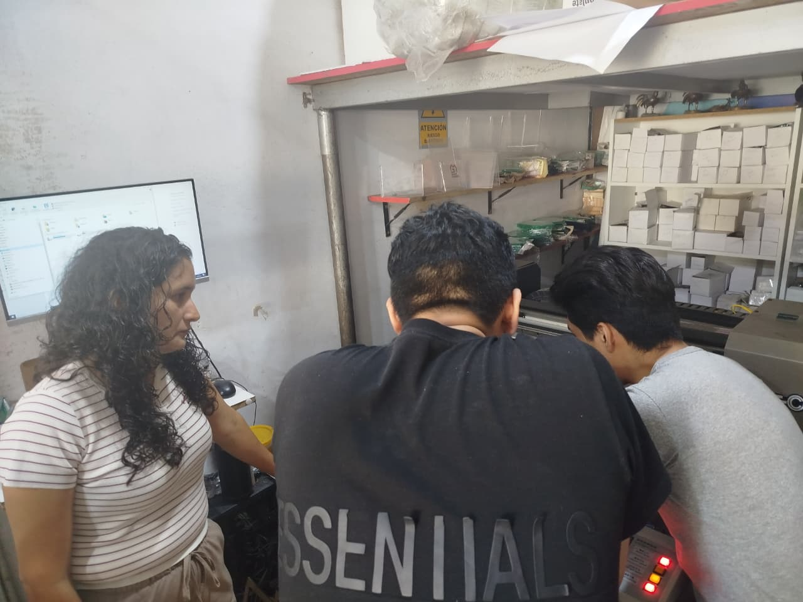

Fuente: registro fotográfico conservado del informe inicial.

#### Figura 2. Observación del equipo de impresión y su estación de operación

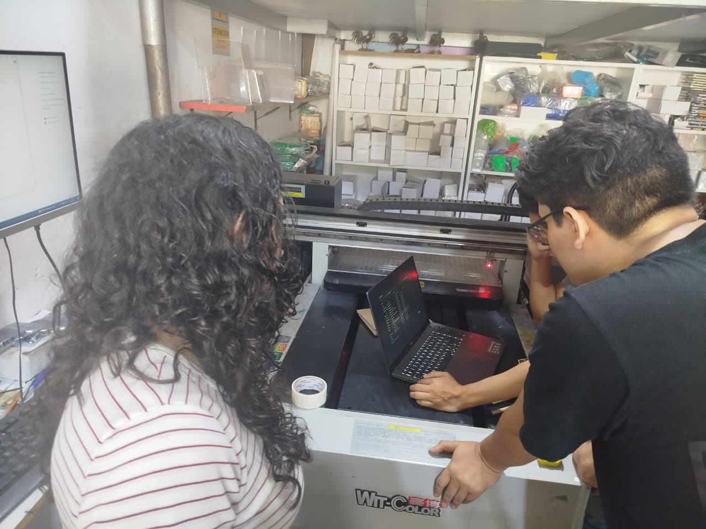

Fuente: registro fotográfico conservado del informe inicial.

#### Figura 3. Revisión del entorno de producción gráfica

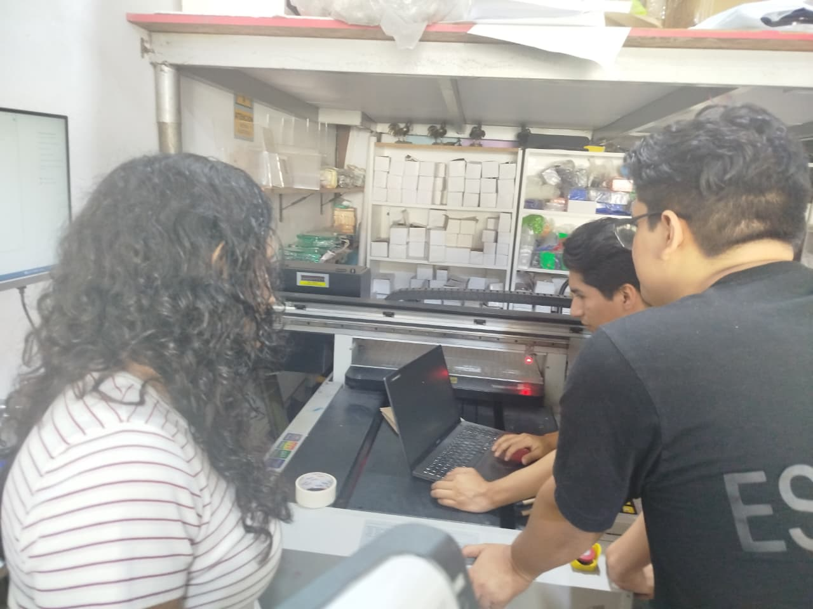

Fuente: registro fotográfico conservado del informe inicial.

#### Figura 4. Observación del trabajo junto al equipo de impresión

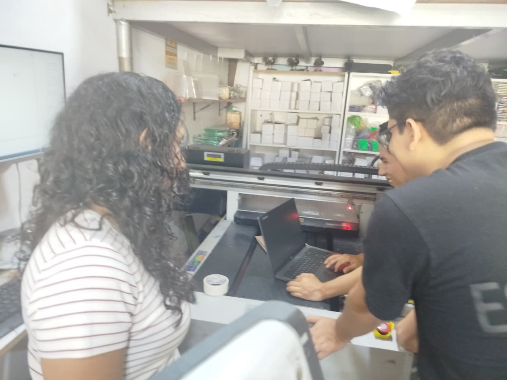

Fuente: registro fotográfico conservado del informe inicial.

#### Figura 5. Participantes en el registro fotográfico del negocio

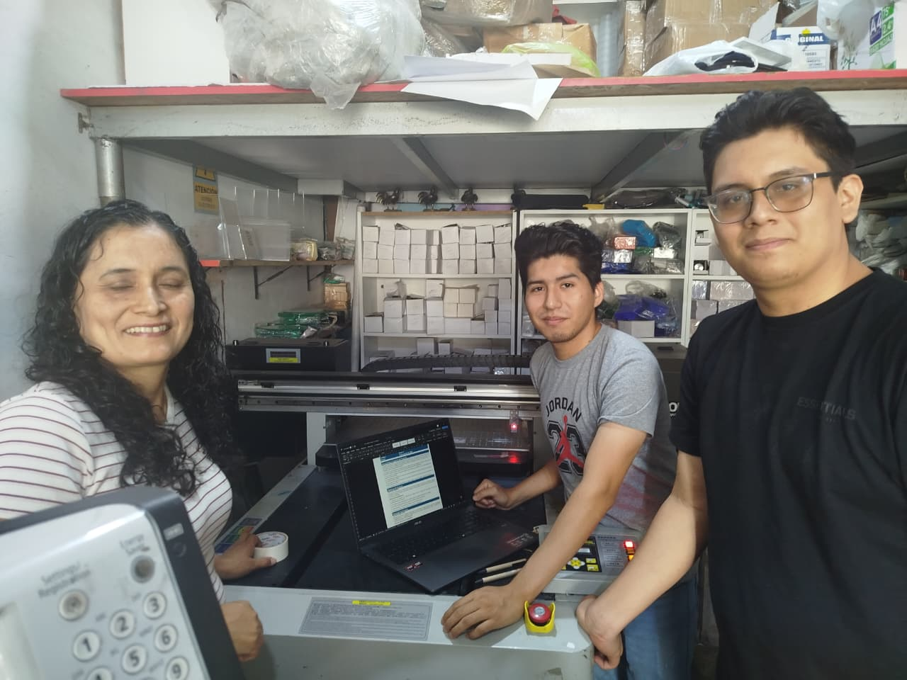

Fuente: registro fotográfico conservado del informe inicial; no se atribuye una nueva fecha o acto de aprobación a esta imagen.

<!-- Fuentes directas del diagnóstico: Contexto del Negocio — Impresos Trujillo (consolidado actualizado el 28/08/2026), secciones de contexto operativo y problemas principales; Informe de Relevamiento de Requerimientos y Hoja de Ruta, diagnóstico de la situación actual; notas de relevamiento sobre saldos, trazabilidad e inventario. Estas notas no acreditan las fechas exactas de entrevistas ni la lista de asistentes mencionadas por el informe previo: no se incorporan esos datos. No se trasladan propuestas obsoletas de infraestructura o facturación que también aparecen en las notas. -->

<!-- Insertar aquí solo figuras o tablas que aporten evidencia verificable. No conservar rótulos ni cuadros vacíos en la versión de entrega. -->

## III. ANÁLISIS DEL PROBLEMA

### 3.1. Antecedentes

**Antecedentes internacionales**

Zamora Irrazabal (2021), en *Desarrollo de una aplicación Web para el Control de Ventas en la Empresa LF Publicidad*, de la Universidad Politécnica Salesiana, Ecuador, abordó el registro de operaciones comerciales mediante módulos de configuración, bodega, ventas y reportes. El desarrollo siguió un proceso organizado en levantamiento de información, análisis, diseño, construcción, pruebas e implementación, presentado bajo la metodología RUP (p. 61). El documento registra **15 casos denominados pruebas unitarias**, correspondientes a las tablas 56–70, y reporta resultados satisfactorios con la indicación «OK» (pp. 62–71; páginas 80–89 del PDF). También describe reportes de ventas generales, por clientes y por empleados. Su aporte al proyecto es la integración de operaciones y consultas comerciales y la documentación de comprobaciones por función. Estos resultados corresponden al funcionamiento del software y no a una reducción medida del tiempo de atención. [Publicación original](https://dspace.ups.edu.ec/handle/123456789/19759).

Loachamin Topón y Buri Naula (2019), en *Desarrollo de un sistema Customer Relationship Management (CRM) para la imprenta Copy&Print*, de la Universidad Tecnológica Israel, Ecuador, desarrollaron una solución orientada a clientes, servicios, órdenes de trabajo, tareas y publicidad mediante Extreme Programming (XP). El levantamiento combinó entrevistas con la gerencia y atención al cliente y una encuesta cuyo tamaño calculado fue de **115 personas**, a partir de una población de referencia de **164 clientes** (p. 19; página 34 del PDF). La evaluación documenta **11 fichas de pruebas de funcionalidad**, tablas 4.20–4.30 (pp. 59–71). Las conclusiones describen la automatización y la participación de usuarios en la retroalimentación del producto (sección 5; página 92 del PDF). Este antecedente aporta un procedimiento de levantamiento y comprobación de funciones para una imprenta; sus datos de muestra y pruebas no se interpretan como porcentajes de mejora de tiempos o cobros. [Publicación original](https://repositorio.uisrael.edu.ec/handle/47000/2052).

**Antecedentes nacionales**

Chávez Gutierrez (2024), en *Sistema web basado en Scrum para la gestión de pedidos en la imprenta “New Imprent Mark S.A.C.” - Tarma*, de la Universidad Nacional del Centro del Perú, evaluó la gestión de pedidos mediante mediciones anteriores y posteriores a la intervención. Reportó que el tiempo promedio de atención por pedido pasó de **30.14 a 14.14 minutos** y que la exactitud de la trazabilidad y control de pedidos pasó de **58% a 96%** (conclusiones, p. 69; página 85 del PDF). El estudio aporta una referencia para operacionalizar el tiempo y el seguimiento de las órdenes. Sus valores describen el contexto investigado y no constituyen resultados ni metas automáticas para Impresos Trujillo. [Publicación original](https://repositorio.uncp.edu.pe/handle/20.500.12894/11669).

Espinoza Reina (2024), en *Implementación de un sistema web para el proceso de cotizaciones en la imprenta Publiprint - Huancayo*, de la Universidad Nacional del Centro del Perú, estudió el proceso de elaboración de cotizaciones. El tiempo promedio reportado disminuyó de **24.06 a 5.67 minutos** (pp. 53–54; páginas 68–69 del PDF). Su aporte es la comparación de una actividad comercial delimitada mediante la misma unidad de medida antes y después de la intervención. Para el presente proyecto se distingue la elaboración de una cotización del registro de una orden, de modo que cada medición tenga hitos propios y comparables. [Publicación original](https://repositorio.uncp.edu.pe/handle/20.500.12894/11008).

**Antecedentes locales**

Rey Ascoy (2023), en *Aplicación web para mejorar el control de los servicios de imprenta en la empresa Corporativo Florián E.I.R.L. 2023*, de la Universidad César Vallejo, Trujillo, evaluó indicadores asociados al registro de pedidos y la generación de reportes. En el indicador de tiempo de registro de pedidos informó una reducción de **661.02 a 68.86 segundos**, equivalente a una diferencia de **592.16 segundos** (conclusiones, p. 31; página 31 del PDF). El antecedente aporta evidencia local para comparar tiempos de registro bajo condiciones definidas; este indicador se diferencia del tiempo de elaboración de reportes. [Publicación original](https://repositorio.ucv.edu.pe/handle/20.500.12692/137054).

González Corvera (2020), en *Propuesta de mejora en el área de operaciones para reducir los costos operacionales de la empresa Imprenta Editora Gráfica Real S.A.C.*, de la Universidad Privada del Norte, Trujillo, analizó logística, calidad y producción mediante diagnóstico de causas y priorización. El resumen institucional identifica **seis causas raíz**, de las cuales se priorizaron **tres**, asociadas a **S/17,479.00 mensuales**; plantea evaluación de proveedores, metodología 5S y mantenimiento preventivo. La evaluación económica de la propuesta reporta **VAN de S/28,394.54, TIR de 55% y relación beneficio/costo de 2.99**. Estos valores corresponden a una evaluación de viabilidad de esa propuesta y no a ahorros ejecutados ni a resultados del sistema de Impresos Trujillo. Su aporte es la relación entre diagnóstico operativo, priorización y justificación económica en una imprenta local. La descripción y las cifras se contrastaron con el resumen institucional reproducido en ALICIA. [Registro institucional](https://hdl.handle.net/11537/24212) y [resumen y metadatos públicos](https://alicia.concytec.gob.pe/vufind/Record/UUPN_7f61008ba90ff63cc8ce4b765c59e14c).

En conjunto, los antecedentes respaldan la pertinencia de estudiar el registro integrado de pedidos, la consulta de información y la medición de procesos en empresas gráficas. Sus metodologías, unidades de análisis y resultados se consideran referencias para el diseño del estudio, sin trasladar sus cifras como línea base o beneficios alcanzados por Impresos Trujillo.

<!-- REVISIÓN 3.1: cinco textos completos cotejados y sexto antecedente sustentado en resumen institucional y metadatos ALICIA. González Corvera sustituye a Huayan, de acceso embargado. El enlace al PDF de González devuelve HTML al consultarlo: no se afirma lectura del texto completo ni se asigna una página inventada. Los internacionales contienen cifras verificables de pruebas/muestra, no estimaciones de impacto temporal. Si la rúbrica exige específicamente comparaciones cuantitativas antes/después en todos los casos, esas cifras no las sustituyen. -->

### 3.2. Identificación y formulación del problema

El diagnóstico del negocio identifica dificultades para consultar los saldos de los pedidos, conocer su situación entre mostrador y producción y relacionar los materiales disponibles con los trabajos solicitados. Las notas de relevamiento describen consultas a conversaciones separadas de WhatsApp y dependencia de la persona que registró el pedido. Estas condiciones motivan el análisis de la relación entre un sistema integrado de información y los procesos operativos y financieros de la empresa.

La empresa también atiende pedidos a crédito para determinados clientes empresariales, previa autorización de la propietaria. Por ello, un saldo pendiente representa una cuenta por cobrar y no constituye, por sí mismo, una pérdida financiera. El análisis diferencia las entregas liquidadas, las entregas a crédito autorizadas y las entregas con saldo sin autorización documentada. El componente predictivo se orienta a estimar la cantidad de pedidos por período para apoyar la planificación del trabajo.

<!-- REVISIÓN 3.2: los hallazgos cualitativos se contrastaron con las notas de relevamiento y el Contexto del Negocio actualizado el 28/08/2026. El Pareto anterior usa frecuencias 48, 28, 22, 15 y 12 que suman 125, pero no se ha aportado el registro de clasificación de incidencias ni la priorización del cliente. No atribuir esos conteos a 125 boletas ni añadir porcentajes hasta verificarlo. Las preguntas siguientes se transcriben de la Matriz de Consistencia; esto verifica su procedencia, no su aprobación ni la veracidad de las premisas. -->

Se conservan también los gráficos causales del informe inicial, sin alterar sus imágenes. Se utilizan como antecedentes del planteamiento del problema: sus cifras monetarias, porcentajes y referencias a pérdidas no constituyen una línea base validada del presente estudio. El análisis actualizado distingue las cuentas por cobrar y el crédito autorizado de una pérdida efectivamente demostrada.

#### Figura 6. Diagrama de Pareto conservado del informe inicial

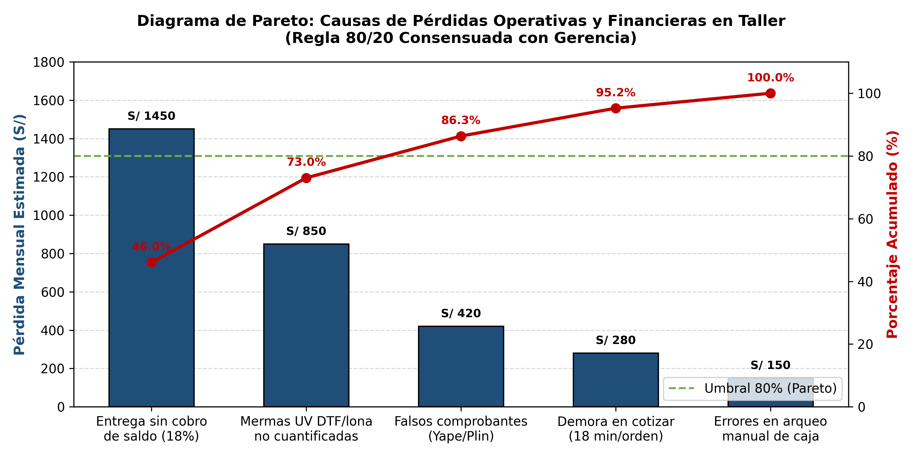

Fuente: material gráfico del informe inicial. Sus importes y porcentajes requieren los registros de origen antes de utilizarse como mediciones del estudio.

#### Figura 7. Diagrama de Ishikawa inicial sobre control de saldos y cobros

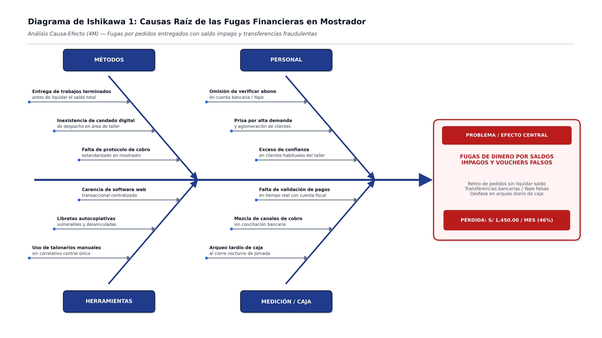

Fuente: material gráfico del informe inicial, conservado sin modificación. La entrega a crédito autorizada no se interpreta como pérdida financiera.

#### Figura 8. Diagrama de Ishikawa inicial sobre materiales y registros de taller


Fuente: material gráfico del informe inicial, conservado sin modificación. Las menciones cuantitativas de merma no sustituyen conteos o mediciones físicas.

##### Tabla 1. Formulación del problema general y problemas específicos

| Nivel | Formulación del problema |
|:---|:---|
| Problema general | ¿De qué manera influye la implementación de un sistema web transaccional con módulos de inteligencia de negocios e inteligencia artificial en la optimización de los procesos operativos y financieros en Impresos Trujillo E.I.R.L., Trujillo - 2026? |
| PE1 | ¿De qué manera influye la implementación del sistema en el tiempo de registro de órdenes de trabajo en Impresos Trujillo E.I.R.L.? |
| PE2 | ¿De qué manera influye la implementación del sistema en el control de inventario de insumos en Impresos Trujillo E.I.R.L.? |
| PE3 | ¿De qué manera influye la implementación del sistema en el control de las entregas con saldo pendiente, considerando el crédito autorizado, en Impresos Trujillo E.I.R.L.? |
| PE4 | ¿De qué manera influye la implementación del sistema en la exactitud de los arqueos diarios de caja en Impresos Trujillo E.I.R.L.? |
| PE5 | ¿De qué manera influye la implementación del módulo de inteligencia artificial en la precisión de la predicción de la cantidad de pedidos por período en Impresos Trujillo E.I.R.L.? |

<!-- REVISIÓN: PE3 se ajusta conjuntamente con OE3, H3 y VD-3 para distinguir crédito autorizado de pérdida. PE5, OE5, H5 y VD-5 se limitan a predicción de pedidos conforme a la precisión del usuario. Las fuentes semanales se mantienen en solo lectura. -->

**Sustento documental del diagnóstico**

Las siguientes evidencias identifican contenidos concretos del relevamiento. E1–E5 son unidades documentales de análisis y no cinco entrevistas independientes. Sus fuentes originales se conservan en los archivos del proyecto y permiten contrastar las causas propuestas.

##### Tabla 1-A. Evidencias objetivas del problema y necesidades derivadas

| Evidencia | Hallazgo y fuente identificable | Necesidad derivada |
|:---|:---|:---|
| E1 | La nota de relevamiento de requerimientos, diagnóstico, registra archivos sobrescritos y pérdida del historial de adelantos y saldos. | N1: conservar un historial de pedidos y pagos consultable. |
| E2 | La misma nota, diagnóstico financiero, describe dificultad para conciliar efectivo, Yape y transferencias por unidad de servicio. | N2: consolidar cobros por medio y línea de negocio. |
| E3 | La nota de seguimiento del negocio, primer párrafo, describe revisión de chats separados para determinar adelantos y saldo pendiente. | N3: consultar saldo y referencias de pago desde la orden. |
| E4 | La nota de seguimiento, primer párrafo, describe dependencia de quien recibió el pedido para identificarlo y continuar la atención. | N4: localizar pedidos y compartir especificaciones y estado según permisos. |
| E5 | La nota de seguimiento, apartados de ubicación de inventario y seguimiento por rollos, solicita localizar materiales y relacionarlos con pedidos. | N5: registrar materiales, ubicación y movimientos vinculados al trabajo. |
| E6 | La nota de seguimiento incluye la entrega antes del pago a clientes empresariales; el relevamiento registra autorización de propietarios para órdenes especiales. | N6: diferenciar crédito autorizado de entrega sin respaldo y mantener la cuenta por cobrar. |

Fuentes: Informe de Relevamiento de Requerimientos y Hoja de Ruta, diagnóstico y control de roles; notas de seguimiento sobre saldos, trazabilidad, inventario y clientes empresariales. Las fotografías de las figuras 1–5 complementan el contexto físico, sin demostrar por sí solas las incidencias descritas.

**Aplicación de tres técnicas de análisis causal**

**Técnica 1 — Ishikawa.** Los diagramas de las figuras 7 y 8 permiten agrupar factores por métodos, personas, herramientas y medición. Al contrastarlos con E1–E6, se retienen como causas de trabajo: C1, fragmentación de registros; C2, ausencia de historial compartido; C3, consulta de pagos separada de la orden; C4, identificación del pedido dependiente de una persona; y C5, relación insuficiente entre movimientos de materiales y pedidos. Los rótulos de fraude y las cifras de merma o pérdidas del gráfico inicial no se consideran causas o efectos demostrados por este contraste.

**Técnica 2 — Árbol de problemas.** Se organiza como problema central la dificultad para reconstruir el estado operativo y financiero de un pedido mediante una referencia común. Sus raíces son C1–C5. Sus ramas son cinco efectos cualitativos documentados o riesgos derivados: Efecto 1, revisión reiterada de chats y archivos; Efecto 2, demoras de consulta durante la atención; Efecto 3, necesidad de contactar a quien recibió el pedido; Efecto 4, dificultad de conciliación por medio de pago y unidad; y Efecto 5, dificultad para consultar ubicación y disponibilidad de materiales. Los tres primeros se vinculan a E3–E4; el cuarto a E2; el quinto a E5. No se asignan frecuencias ni importes sin registros adicionales. Los actores afectados son oficina, taller, administración y clientes que esperan información de su pedido.

**Técnica 3 — Cinco porqués.** Se analiza la pregunta «¿Por qué cuesta determinar el saldo de un pedido al atender una consulta?». Primer porqué: es necesario revisar mensajes separados (E3). Segundo: los adelantos y referencias no se consultan desde un único historial de la orden (E1 y E3). Tercero: se emplean soportes y conversaciones independientes (diagnóstico y E1). Cuarto: la continuidad depende de la memoria o disponibilidad de quien registró la operación (E4). Quinto: el flujo observado carece de una referencia compartida que integre pedido, pagos y responsables (síntesis de E1, E3 y E4). La cadena identifica una hipótesis causal de ingeniería contrastable, no un experimento que descarte todas las causas alternativas.

La respuesta de diseño a estas causas es registrar una orden identificable, asociar los pagos y las autorizaciones, compartir información según funciones y conservar movimientos trazables. Su comprobación se vincula con los indicadores VD-1 a VD-4 y con los casos de aceptación. El Pareto de la figura 6 se conserva como antecedente gráfico y no se contabiliza como técnica cuantitativa aplicada con datos validados.

### 3.3. Definición de variables


La variable independiente corresponde al sistema web transaccional con componentes de inteligencia de negocios e inteligencia artificial. La variable dependiente corresponde a la optimización de los procesos operativos y financieros de Impresos Trujillo E.I.R.L. La primera representa la solución tecnológica de estudio; la segunda, el desempeño de los procesos sobre los que se evalúa su influencia.

##### Tabla 2. Definición de variables

| Variable | Definición conceptual | Definición operacional propuesta | Aspectos de evaluación |
|:---|:---|:---|:---|
| **VI: Sistema web transaccional con módulos de inteligencia de negocios e inteligencia artificial** | Solución integrada para registrar y procesar operaciones, consultar información analítica y apoyar la estimación de la cantidad de pedidos por período. | Evaluación de funciones especificadas mediante criterios de aceptación y casos de prueba trazables. | Gestión transaccional, cobros y caja, inteligencia de negocios e inteligencia artificial. |
| **VD: Optimización de los procesos operativos y financieros** | Mejora del desempeño en el registro de pedidos, control de insumos, cobranza, conciliación de caja y planificación del trabajo. | Comparación de indicadores de proceso entre condiciones documentadas y evaluación temporal del pronóstico frente a una referencia. | Tiempo de registro, discrepancias de inventario, control de saldos, conciliación de caja y error del pronóstico de pedidos. |

<!-- REVISIÓN 3.3: mantener separados el cumplimiento funcional de la VI y los indicadores de desempeño de la VD. La evaluación de IA utiliza pedidos por período; el control de inventario se conserva como proceso transaccional independiente. -->

### 3.4. Definición de objetivos

**3.4.1. Objetivo general**

Determinar la influencia de la implementación de un sistema web transaccional con módulos de inteligencia de negocios e inteligencia artificial en la optimización de los procesos operativos y financieros en Impresos Trujillo E.I.R.L., Trujillo - 2026.

**3.4.2. Objetivos específicos**

1. Determinar la influencia de la implementación del sistema en el tiempo de registro de órdenes de trabajo en Impresos Trujillo E.I.R.L.
2. Determinar la influencia de la implementación del sistema en el control de inventario de insumos en Impresos Trujillo E.I.R.L.
3. Determinar la influencia de la implementación del sistema en el control de las entregas con saldo pendiente, considerando el crédito autorizado, en Impresos Trujillo E.I.R.L.
4. Determinar la influencia de la implementación del sistema en la exactitud de los arqueos diarios de caja en Impresos Trujillo E.I.R.L.
5. Determinar la influencia del módulo de inteligencia artificial en la precisión de la predicción de la cantidad de pedidos por período en Impresos Trujillo E.I.R.L.

<!-- REVISIÓN 3.4: se conserva el enfoque de investigación «Determinar la influencia», confirmado por el usuario. El control de crédito y el pronóstico de pedidos se corresponden con los ajustes de alcance descritos en 3.2. -->

### 3.5. Población

La población de estudio está constituida por las órdenes de trabajo de las líneas de imprenta comercial y gigantografía comprendidas en los períodos definidos para la evaluación. Para la revisión del archivo físico se propone la ventana histórica del **01/08/2026 al 30/09/2026**, correspondiente a meses anteriores al corte de revisión. Su delimitación efectiva depende de las fechas e integridad de los documentos conservados. Las fuentes digitales se contrastan al corte del **24/10/2026**, sin presumir que cubren esos mismos meses. Para los indicadores asociados a pedidos, la unidad de análisis es una orden de trabajo individual. Caja e inventario requieren unidades diferenciadas: cierre de caja y material cotejado.

La revisión técnica del 24/10/2026 identificó **378 órdenes digitales**, de las cuales **370 corresponden a órdenes no canceladas con importe positivo**. Este conteo describe la disponibilidad de registros en la fecha de consulta; la delimitación de la población analítica depende de los períodos y criterios de inclusión de cada indicador.

<!-- REVISIÓN 3.5: el usuario informa aproximadamente seis talonarios completos; no existe aún conteo verificable de sus órdenes. El total digital no es la población histórica completa ni demuestra la disponibilidad del pretest. Falta cerrar fechas de evaluación, verificar duplicados entre papel y sistema y distinguir contratos/proformas de pedidos confirmados antes de congelar la población analítica. -->

### 3.6. Muestra

Se propone una **muestra documental de 200 órdenes de trabajo**, seleccionadas mediante un procedimiento no probabilístico consecutivo. Para el archivo físico se toma como ventana propuesta **agosto y septiembre de 2026**; los registros digitales se analizan según su cobertura comprobada al corte. Se incluyen órdenes identificables de imprenta comercial y gigantografía con fecha, importe y datos suficientes para el indicador correspondiente. Se excluyen duplicados, registros de prueba, órdenes canceladas y documentos que no permitan confirmar la operación. La selección conserva el orden cronológico y documenta la condición de observación y el motivo de cada exclusión.

Los registros en papel y digitales se cotejan para evitar contar dos veces una misma orden. Las condiciones inicial y posterior deben utilizar criterios equivalentes de selección y clasificación por línea de negocio y tipo de trabajo. El tamaño propuesto corresponde al conjunto documental y no implica 200 órdenes por condición ni 200 observaciones emparejadas. La selección consecutiva permite examinar las operaciones incluidas, sin garantizar representatividad probabilística de toda la actividad de la empresa.

Los cronometrajes requieren observación directa con hitos de inicio y fin; las boletas sin esas mediciones no permiten reconstruir el tiempo de registro. Los cierres de caja y conteos físicos se delimitan según sus propias unidades de observación. Para el pronóstico se utiliza la serie temporal elegible de pedidos, cuya suficiencia depende del número de períodos y de la cobertura histórica, no únicamente de alcanzar 200 órdenes.

<!-- REVISIÓN 3.6: 200 es la muestra propuesta solicitada por el usuario. Se propone archivo histórico de agosto–septiembre de 2026; falta confirmar que los talonarios cubran esas fechas, distribución inicial/posterior, elegibilidad, digitalización y lista final anonimizada. La extracción técnica de 200 órdenes de producción comprueba factibilidad de consulta, no constituye selección definitiva del estudio ni acredita un pretest. No fijar una distribución 100/100 sin verificarla. -->

### 3.7. Matriz de dimensiones e indicadores

La matriz relaciona las variables con los aspectos a medir, sus indicadores y las unidades de observación. Las mediciones requieren fórmulas, denominadores y criterios de inclusión estables, de manera que puedan reproducirse y compararse.

##### Tabla 3. Matriz de dimensiones e indicadores

| Variable | Dimensión propuesta | Indicador | Definición operacional propuesta | Escala | Fuente de medición |
|:---|:---|:---|:---|:---|:---|
| VI | Gestión transaccional | VI-1 Cobertura funcional transaccional (%) | Funciones que cumplen los criterios de aceptación / funciones especificadas del grupo × 100 | Razón | Requisitos y reporte de pruebas |
| VI | Gestión transaccional | VI-2 Cobertura funcional de cobros y caja (%) | Funciones de cobros/caja que cumplen los criterios / funciones especificadas del grupo × 100; no duplicar funciones entre grupos | Razón | Requisitos y reporte de pruebas |
| VI | Inteligencia de negocios | VI-3 Cobertura funcional analítica (%) | Funciones analíticas que cumplen los criterios / funciones analíticas especificadas × 100 | Razón | Requisitos y reporte de pruebas |
| VI | Inteligencia artificial | VI-4 Cobertura funcional predictiva (%) | Funciones predictivas que cumplen los criterios / funciones predictivas especificadas × 100 | Razón | Requisitos y reporte de pruebas |
| VD | Eficiencia operativa | VD-1 Tiempo promedio de registro (min) | Suma de duraciones de registro / número de órdenes cronometradas, usando los mismos hitos de inicio y fin | Razón | Ficha de cronometraje |
| VD | Control de inventario | VD-2 Materiales con discrepancia (%) | Materiales cuyo saldo registrado difiere del conteo físico por encima de la tolerancia de medición / materiales cotejados × 100; cada cotejo usa la misma unidad y fecha de corte | Razón | Registro de stock y ficha de conteo físico |
| VD | Control financiero | VD-3 Entregas con saldo sin autorización documentada (%) | Entregas con saldo y sin autorización documentada / entregas con saldo × 100; clasificar por separado el crédito autorizado | Razón | Órdenes, pagos, evidencia de entrega y autorizaciones |
| VD | Control financiero | VD-4 Exactitud de arqueos (%) | Cierres sin discrepancia no explicada superior a S/0.01 / cierres evaluados × 100, contrastando efectivo contado y referencias de cobro por medio de pago | Razón | Ficha de conciliación, conteo de efectivo y comprobantes |
| VD | Planificación de pedidos | VD-5 Error absoluto medio del pronóstico de pedidos (MAE) | Suma de diferencias absolutas entre cantidad real y pronosticada / número de períodos de prueba; comparar modelo y referencia sobre los mismos períodos | Razón; pedidos por período | Serie temporal de pedidos y registro de pronósticos fuera de entrenamiento |

Cuando el denominador de un indicador sea cero, se registra como no aplicable en lugar de asignarle un resultado de 0% o 100%. En inventario, la tolerancia se fija por material según su unidad y resolución de medición antes de recoger los datos. La discrepancia de inventario no equivale a merma física. En saldos, la falta de autorización documentada identifica una incidencia de control y no demuestra una pérdida monetaria.

Como parte del alcance, se contempla un componente de IA para apoyar la previsión de pedidos. Su evaluación posterior utilizará datos separados temporalmente y el error absoluto medio (MAE), definido en la matriz; en este avance no se presentan resultados predictivos.

<!-- REVISIÓN 3.7: las fórmulas son una propuesta operacional coherente con el alcance confirmado. Fijar calendario operativo, fechas de entrenamiento/prueba y tolerancias por material antes de ejecutar el estudio. El control de cobros no constituye un indicador directo de pérdidas; para medir pérdidas se necesitarían vencimientos e incobrabilidad documentados. -->

### 3.8. Matriz de consistencia

La investigación plantea un enfoque cuantitativo, de tipo aplicado, y un diseño preexperimental de un grupo para los indicadores operativos y financieros, con medición inicial y posterior: O₁ → X → O₂. En este esquema, X representa la intervención mediante el sistema y O₁/O₂ las mediciones de los indicadores de los procesos. Las hipótesis expresan efectos que serán contrastados y no resultados anticipados.

La interpretación debe considerar las condiciones de operación, las diferencias entre pedidos y las limitaciones de un diseño sin grupo de control. La evaluación del pronóstico requiere, adicionalmente, una serie temporal y un procedimiento de prueba distinto de la simple comparación de órdenes antes y después.

##### Tabla 4. Matriz de consistencia

| Nivel | Problema de investigación | Objetivo | Hipótesis de investigación | Variables e indicadores | Técnica e instrumento |
|:---|:---|:---|:---|:---|:---|
| General | ¿De qué manera influye el sistema web transaccional con inteligencia de negocios e inteligencia artificial en la optimización de los procesos operativos y financieros de Impresos Trujillo E.I.R.L., Trujillo - 2026? | Determinar la influencia de la implementación del sistema en la optimización de dichos procesos. | La implementación del sistema mejora el desempeño de los procesos operativos y financieros evaluados. | VI: sistema web; VD: desempeño de procesos. VI-1 a VI-4 y VD-1 a VD-5, sin agregarlos en un índice único. | Pruebas funcionales, observación, revisión documental, conteo físico y evaluación temporal de pronósticos. |
| PE1 / OE1 / H1 | ¿De qué manera influye el sistema en el tiempo de registro de órdenes? | Determinar la influencia del sistema en el tiempo de registro de órdenes. | El tiempo promedio de registro es menor en la condición posterior. | VI-1; VD-1: minutos por orden. | Observación y cronometraje; INST-01. |
| PE2 / OE2 / H2 | ¿De qué manera influye el sistema en el control de inventario de insumos? | Determinar la influencia del sistema en el control de inventario de insumos. | El porcentaje de materiales con discrepancia es menor en la condición posterior. | VI-1; VD-2: materiales con discrepancia (%). | Cotejo de stock y conteo físico; ficha de conciliación de inventario. |
| PE3 / OE3 / H3 | ¿De qué manera influye el sistema en el control de entregas con saldo, considerando el crédito autorizado? | Determinar la influencia del sistema en dicho control. | El porcentaje de entregas con saldo sin autorización documentada es menor en la condición posterior. | VI-2; VD-3: entregas con saldo sin autorización documentada (%). | Revisión documental; INST-03, órdenes, pagos y autorizaciones. |
| PE4 / OE4 / H4 | ¿De qué manera influye el sistema en la exactitud de los arqueos diarios de caja? | Determinar la influencia del sistema en la exactitud de los arqueos diarios. | El porcentaje de cierres sin discrepancia no explicada es mayor en la condición posterior. | VI-2; VD-4: exactitud de arqueos (%). | Conciliación documental y conteo de efectivo; INST-03. |
| PE5 / OE5 / H5 | ¿De qué manera influye la IA en la precisión de la predicción de la cantidad de pedidos por período? | Determinar la influencia de la IA en la precisión de esa predicción. | El modelo presenta menor MAE que la referencia simple en los mismos días de prueba. | VI-4; VD-5: MAE, en pedidos por día. | Análisis de serie temporal; ficha de evaluación de pronósticos. |

La muestra documental propuesta es de 200 órdenes. Los indicadores de caja e inventario se observan en sus unidades respectivas y el pronóstico se contrasta sobre períodos temporales separados del entrenamiento. El cumplimiento funcional analítico, VI-3, se verifica mediante criterios de aceptación de los reportes que apoyan la consulta de los indicadores; no se utiliza como sustituto de la mejora operativa.

<!-- REVISIÓN 3.8: no asumir emparejamiento entre órdenes distintas. Elegir el contraste estadístico según la unidad, independencia, distribución y tamaño efectivamente obtenidos. La hipótesis predictiva utiliza validación temporal, no un supuesto pretest/postest de un modelo todavía no evaluado. Si una tasa carece de denominador o ya está en su valor óptimo inicial, no afirmar mejora de esa tasa. -->

### 3.9. Técnicas e instrumentos de recolección de datos

Las técnicas e instrumentos se seleccionan según el dato requerido por cada indicador. Cada registro debe identificar la unidad observada, la condición de medición, la fecha y el procedimiento aplicado, utilizando identificadores anonimizados cuando corresponda.

##### Tabla 5. Correspondencia entre técnica, instrumento y dato de medición

| Técnica | Instrumento | Dato de medición | Registro de respaldo |
|:---|:---|:---|:---|
| Observación y cronometraje | INST-01: ficha de tiempos | Duración del registro de una orden | Identificador anonimizado, inicio/fin y condición de medición |
| Inspección y conteo físico | Ficha de conciliación de inventario | Saldo registrado, cantidad física y diferencia por material | Material anonimizado, fecha de corte, unidad y tolerancia de medición |
| Inspección y medición física complementaria | INST-02: ficha de consumo y merma | Material tomado, retazo reutilizable y descarte físico | Identificación del material/lote y medidas en unidades compatibles; no sustituye el conteo de inventario |
| Revisión documental y conciliación | INST-03: ficha de caja y entrega | Totales por medio de pago, diferencias de caja y condición de entrega | Cierre, pagos conformes y autorizaciones de crédito |
| Prueba de aceptación | Lista de comprobación funcional | Criterio esperado, resultado observado y evidencia por función | Requisito, caso de prueba, versión del sistema y resultado |
| Revisión documental y análisis temporal | Ficha de evaluación de pronósticos | Cantidad real, predicción del modelo y predicción de referencia por día | Identificador del modelo, fechas de corte, horizonte, exclusiones y MAE |
| Encuesta complementaria de usabilidad | INST-04: cuestionario SUS | Percepción de usabilidad expresada en puntaje de 0–100 | Respuestas anonimizadas, versión del cuestionario y regla de puntuación; no interviene en las cinco hipótesis principales |

La extracción digital conserva únicamente los campos necesarios para cada cálculo y utiliza identificadores anonimizados en las fichas de análisis. La fecha de creación de una orden identifica el momento de registro en el sistema, pero no mide cuánto duró la atención. Los pagos y saldos se contrastan con sus referencias comerciales; la autorización de crédito se respalda con evidencia de la propietaria. Los instrumentos de consumo y usabilidad aportan información complementaria y no reemplazan las mediciones principales de inventario, caja o tiempos.

<!-- REVISIÓN 3.9: las fichas de conciliación de inventario, comprobación funcional y pronósticos se especifican aquí como instrumentos propuestos; no se afirma que existan fichas aplicadas. No editar las fichas semanales en esta revisión. Antes de aplicar SUS se requiere una versión publicada en español y su referencia exacta. -->

### 3.10. Validación y confiabilidad de datos

La verificación de las fichas de medición objetiva se plantea mediante trazabilidad entre indicador, campo y fuente; comprobación de fórmulas y unidades; contraste con documentos y conteos de referencia; y pruebas de repetición de las mediciones. El procedimiento se documenta con registros de aplicación e incidencias, sin recurrir a juicio de expertos. Cada ficha debe permitir reconstruir el cálculo desde los datos de origen.

Para el cronometraje y el conteo físico se propone evaluar repetibilidad bajo las mismas condiciones y reproducibilidad entre observadores, conservando las diferencias de lectura y la resolución del instrumento. El *NIST/SEMATECH e-Handbook of Statistical Methods*, sección [Gauge R & R studies](https://www.itl.nist.gov/div898/handbook/mpc/section4/mpc4.htm), sustenta la caracterización de errores de medición mediante repetibilidad, reproducibilidad y estabilidad. Estos principios orientan las mediciones objetivas; no equivalen a validar un cuestionario de percepción ni a demostrar un efecto del sistema.

La revisión de integridad de los datos digitales efectuada el **24/10/2026** se realizó mediante consultas de solo lectura. En los registros examinados no se encontraron pagos sin orden asociada. En las **370 órdenes no canceladas** tampoco se detectaron diferencias superiores a **S/0.01** entre el saldo registrado y el máximo entre cero y el importe total menos los pagos conformes. Esta comprobación respalda la consistencia aritmética y referencial de los campos consultados; no sustituye el cotejo con el efectivo físico ni con los documentos comerciales.

Como prueba técnica de extracción se recuperaron **200 órdenes distintas**, no canceladas y con importe positivo, ordenadas por fecha e identificador. En ese conjunto no se detectaron saldos negativos ni superiores al importe de la orden. La repetición de la consulta sobre la misma instantánea de lectura devolvió el mismo conjunto de identificadores. Esto verifica la reproducibilidad de la selección técnica, sin demostrar por sí solo exactitud frente a la realidad ni constituir la muestra definitiva de comparación inicial y posterior.

Para la transcripción de las órdenes físicas se propone una segunda lectura independiente y la conciliación de discrepancias contra el original. El acuerdo entre lecturas se calcula sobre los campos efectivamente cotejados y se informa junto con el número de registros revisados y las correcciones realizadas. En el pronóstico, las reglas de agregación se comprueban contra las órdenes de origen y la partición temporal se fija antes de evaluar el modelo.

Para el cuestionario complementario de usabilidad se debe identificar una versión publicada en español, conservar sus ítems y escala y aplicar la regla de puntuación correspondiente. Los coeficientes estadísticos solo se reportan cuando existen respuestas y un análisis apropiado para la escala y la muestra. Las verificaciones de extracción y conciliación no se presentan como validación de constructo ni como aplicación del cuestionario.

<!-- REVISIÓN 3.10: evidencia técnica en .temp/revisar_datos_informe.py y .temp/revision_bd_quality.txt; extracción repetida en .temp/revision_bd_sample.txt. Se verificaron integridad, conciliación aritmética y reproducibilidad de consulta, no un piloto de tiempos, inventario físico, caja física, SUS o modelo predictivo. No existen resultados que permitan declarar esos procedimientos aplicados ni reducción causal. La base consultada no contiene registros de consumo por orden o pieza; los movimientos de stock por sí solos no acreditan mermas ni conteos físicos. La ausencia de autorizaciones registradas no contradice la política de crédito descrita por la propietaria. -->

##### Tabla 6. Protocolo de verificación de instrumentos

| Instrumento/versión | Procedimiento | Evidencia a conservar | Métrica posible |
|:---|:---|:---|:---|
| INST-01 Tiempo | Probar hitos de cronometraje en órdenes de prueba; contrastar mediciones duplicadas | Fichas anonimizadas y diferencias entre mediciones | Concordancia/variación de mediciones |
| Conciliación de inventario | Cotejar saldo y conteo físico al mismo corte; repetir lecturas en la misma unidad | Fichas de conteo, tolerancia y diferencias por material | Materiales con discrepancia (%) y variación entre lecturas |
| INST-02 Merma, complementario | Aplicar fórmula y unidades acordadas a lotes/órdenes de prueba | Medidas de material, retazos y descarte | Repetibilidad de lectura y consistencia de cálculo |
| INST-03 Caja y entrega | Reconciliar pagos conformes, cierre, efectivo contado y referencias; clasificar autorización de saldos | Consultas anonimizadas, conteos y documentos de respaldo | Coincidencia aritmética, exactitud de arqueos e incidencias documentadas |
| Extracción documental | Repetir consulta en una instantánea de lectura y realizar doble lectura de documentos físicos | Consulta versionada, huella del conjunto y registro de correcciones | Coincidencia de selección y acuerdo por campo cotejado |
| Comprobación funcional | Contrastar cada caso con su criterio de aceptación | Requisito, versión y evidencia de ejecución | Funciones conformes / funciones especificadas × 100 |
| Evaluación de pronósticos | Cotejar agregación con órdenes; separar entrenamiento y prueba; evaluar modelo y referencia con el mismo horizonte | Serie anonimizada, cortes temporales y pronósticos guardados | MAE del modelo y de la referencia, en pedidos por día |
| INST-04 SUS, complementario | Seleccionar versión publicada en español; conservar ítems y regla de puntuación | Referencia de la versión, formularios anonimizados y puntajes | Puntaje SUS; consistencia interna solo si los datos permiten estimarla |

## IV. HERRAMIENTAS DE INGENIERÍA

**Comparación de metodologías o marco de trabajo y estándares de ingeniería, selección de lo que se utilizaría (justificar).**

La selección del marco de trabajo considera un equipo de tres integrantes con responsabilidades de desarrollo compartidas, la participación de la administración y el taller, y la necesidad de precisar reglas comerciales mediante la revisión del producto. Entre estas reglas se encuentran el registro de órdenes, los pagos parciales, las autorizaciones de crédito y los estados de producción. La comparación se realiza con criterios de adaptación, retroalimentación y coordinación, sin asignar puntuaciones que no provengan de una evaluación documentada.

##### Tabla 7. Comparación de metodologías y marcos de trabajo

| Opción evaluada | Organización del trabajo | Adecuación al proyecto | Selección |
|:---|:---|:---|:---|
| Desarrollo secuencial en cascada | Organiza el trabajo en fases con resultados definidos y revisión de sus dependencias. | Facilita una planificación documental inicial, pero los cambios de reglas descubiertos al revisar las pantallas pueden exigir volver sobre productos de fases anteriores. | Se conserva la planificación por hitos como apoyo de gestión; no se selecciona como enfoque principal de construcción. |
| Scrum | Ordena el trabajo en un Product Backlog y organiza incrementos mediante Sprints, inspección y adaptación. | Permite priorizar procesos comerciales, revisar incrementos con los usuarios y ajustar el trabajo conforme se precisan las necesidades del negocio. | Marco seleccionado en el Plan de Desarrollo de Software. |
| Kanban | Visualiza el flujo de trabajo y permite gestionar el trabajo en curso. | Resulta útil para observar tareas e incidencias, pero la visualización del flujo por sí sola no define los objetivos y las revisiones de los Sprints. | Técnica complementaria para visualizar el trabajo; el tablero de estados de pedidos corresponde, además, al proceso productivo del negocio. |
| Extreme Programming (XP) | Propone prácticas de desarrollo orientadas a retroalimentación y calidad técnica. | Sus prácticas de pruebas y revisión del código son pertinentes, aunque la organización del proyecto está definida alrededor de un backlog e incrementos. | Referencia complementaria de prácticas técnicas, sin declarar la adopción integral de XP. |

Se selecciona **Scrum** como marco de referencia por su orientación a incrementos y adaptación a partir de la inspección del producto. La [Guía Scrum de Schwaber y Sutherland (2020)](https://scrumguides.org/scrum-guide.html) establece el Product Backlog, el Sprint Backlog y el Incremento, junto con sus compromisos: objetivo del producto, objetivo del Sprint y definición de terminado. En el proyecto, esta organización permite relacionar los requerimientos priorizados con las funciones que se presentan a los usuarios y con sus criterios de aceptación. La ejecución de los eventos y los incrementos se documenta en el desarrollo de la metodología.

Los estándares de ingeniería cumplen una función distinta y complementaria al marco de trabajo. La especificación de requerimientos del proyecto utiliza una estructura documental identificada como IEEE 830, que organiza funciones, restricciones y requisitos no funcionales. Esta referencia se conserva como antecedente de la organización del documento, sin presentarla como un estándar vigente de gestión ágil. Para orientar los criterios de calidad del producto se toma como referencia **ISO/IEC 25010:2023**, cuyo [modelo de calidad de producto](https://www.iso.org/standard/78176.html) permite especificar y evaluar propiedades del software. Su aplicación se concreta en criterios verificables de adecuación funcional, eficiencia de desempeño, fiabilidad, seguridad y mantenibilidad, vinculados con los requisitos y las pruebas. La selección de este modelo no implica una certificación del sistema.

Así, Scrum orienta la organización e inspección del trabajo; la especificación de requisitos define el comportamiento esperado; y el modelo de calidad orienta los aspectos que deben comprobarse. Esta separación permite relacionar necesidad del usuario, requisito, función y evidencia de prueba.

<!-- REVISIÓN IV: la selección de Scrum procede del PDS; la comparación es una justificación cualitativa del informe, no una matriz de puntuaciones aprobada por el cliente. No atribuir eventos, actas, aceptación o prácticas de XP a ejecuciones no acreditadas. ISO/IEC 25010:2023 se explicita como referencia para desarrollar los criterios de calidad; al revisar VI se debe mantener la misma edición y no copiar automáticamente las características de 2011. -->

**Selección de las herramientas hardware y software, fundamentado.**

La solución utiliza una arquitectura web con interfaz Angular, API FastAPI y base de datos PostgreSQL. Esta separación permite modificar las pantallas, las reglas del negocio y la persistencia con responsabilidades diferenciadas. El acceso mediante navegador aprovecha los equipos de oficina y taller y permite atender el requisito de consulta desde dispositivos móviles. El procesamiento de las operaciones y la conservación de los registros se concentran en el servidor.

La elección de Angular se fundamenta en la organización de la interfaz mediante componentes y en sus herramientas de navegación y formularios, descritas en la [documentación oficial](https://angular.dev/overview). FastAPI se selecciona por la definición tipada de los datos, la validación de solicitudes y la documentación de la API mediante OpenAPI, según sus [características oficiales](https://fastapi.tiangolo.com/features/). Estas capacidades apoyan la consistencia del intercambio de información entre la interfaz y las reglas del negocio, sin sustituir las pruebas de la aplicación.

##### Tabla 8. Herramientas y recursos utilizados

| Herramienta o recurso | Uso en el proyecto | Entorno | Fundamento de selección |
|:---|:---|:---|:---|
| Equipos de desarrollo del equipo | Edición de código, compilación de la interfaz, ejecución de pruebas y trabajo con contenedores. | Desarrollo y pruebas. | Aprovechan los recursos del equipo; su capacidad debe permitir ejecutar el entorno de desarrollo y las comprobaciones sin afectar los equipos operativos de la empresa. |
| Computadoras existentes y dispositivos móviles | Registro, consulta y seguimiento de pedidos mediante navegador. | Oficina y taller. | La aplicación web permite reutilizar los equipos y acceder desde distintos tamaños de pantalla, sin adquirir estaciones exclusivas para instalar el sistema. |
| Conectividad de la empresa | Comunicación con el sistema alojado en el servidor. | Oficina y taller. | El contexto del negocio registra una conexión de 200 Mbps; la operación web también depende de su disponibilidad y estabilidad. |
| VPS particular propio | Alojamiento de la interfaz, la API y la base de datos. | Servidor de producción. | Centraliza el acceso y permite administrar los servicios, las redes y la persistencia en infraestructura bajo control del proyecto. |
| Angular 21 y TypeScript | Construcción de componentes, formularios, navegación y vistas de consulta. | Interfaz web. | Permiten organizar las pantallas con una estructura común y mantener una separación entre presentación y acceso a la API. |
| Python 3.13 y FastAPI | Implementación de la API y de las reglas de pedidos, pagos, caja e inventario. | Backend. | Integran validación de datos y contratos de API; Python también permite preparar el procesamiento analítico del proyecto. |
| PostgreSQL 17 | Persistencia relacional de órdenes, pagos, cierres y demás entidades del negocio. | Desarrollo y producción, en contenedor. | El modelo relacional permite vincular operaciones y conservar restricciones de integridad; los registros sirven además como fuente de consultas analíticas. |
| SQLAlchemy y Alembic | Acceso a datos y gestión versionada de cambios del esquema. | Backend y mantenimiento de la base de datos. | Mantienen la relación entre el modelo de la aplicación y la evolución de la estructura persistente. |
| Docker y Docker Compose | Definición y ejecución de los servicios de base de datos, API e interfaz. | Desarrollo y servidor. | Expresan la configuración de los servicios y sus dependencias; los volúmenes permiten conservar datos fuera del ciclo de reconstrucción de las imágenes. |
| Git y repositorio GitHub | Control de versiones del código y de la configuración del proyecto. | Colaboración del equipo. | Permiten identificar cambios, revisar diferencias y relacionar una evidencia técnica con una versión del producto. |
| SQL y scripts de Python | Extracción de agregados, comprobación de reglas y preparación de datos. | Revisión de datos y análisis. | Permiten guardar el procedimiento y repetir cálculos sobre una fuente y un corte identificados. |

Para el **usuario final** se requiere un navegador compatible con la aplicación, conectividad con el servidor y credenciales acordes con sus funciones. Las pantallas deben permitir identificar los campos obligatorios, consultar el saldo y distinguir el estado del pedido y las autorizaciones de crédito. La adaptación a computadora y celular se verifica en las pruebas de aceptación; la velocidad contratada de internet no garantiza por sí sola el tiempo de respuesta del sistema.

Para el **servidor** se requiere un entorno capaz de ejecutar los contenedores, almacenamiento persistente para la base de datos y los archivos de las operaciones, acceso HTTPS y administración del servicio. La configuración de producción separa la red interna de la aplicación del punto de entrada web. El dimensionamiento de CPU, memoria y almacenamiento se establece según el volumen de datos, los usuarios concurrentes, el crecimiento esperado y las mediciones de carga. La capacidad disponible del servidor no se considera automáticamente un requisito mínimo validado.

El entorno Python también permite contemplar el componente de previsión de pedidos incluido en el alcance. Su selección técnica y evaluación corresponden a una etapa posterior.

<!-- REVISIÓN IV: versiones contrastadas con frontend/package.json, backend/requirements.txt, backend/Dockerfile, docker-compose.yml y docs/despliegue/vps/docker-compose.yml. El PDS menciona Python 3.11/PostgreSQL 16; el repositorio consultado define Python 3.13/PostgreSQL 17. No trasladar Prophet, entrenamiento, automatización CI/CD o requisitos numéricos de hardware como hechos ejecutados sin evidencia específica. El contexto registra 6–8 computadoras y el PDS cita 6: se evita fijar un inventario de hardware sin verificación. Faltan inventario técnico, asignación efectiva de recursos del VPS y pruebas de carga para establecer mínimos cuantificados. -->

**Uso correcto de herramientas: recolección de datos, análisis de datos, procesamiento de datos.**

La **recolección de datos** comprende dos fuentes: los documentos comerciales conservados por la empresa y los registros digitales del sistema. Para los documentos físicos, el procedimiento contempla identificar la orden, registrar sus campos y cotejar la transcripción con el original. Para la fuente digital, las consultas seleccionan únicamente los campos necesarios para el indicador y conservan las reglas de inclusión, exclusión y corte. Las fichas de cronometraje, inventario y caja definidas en el capítulo III complementan las fuentes documentales con observaciones que una boleta o una fecha de creación no permiten reconstruir.

El **procesamiento de datos** comprende la revisión de duplicados, la normalización de fechas, líneas de negocio, estados y medios de pago, y el control de relaciones entre órdenes y pagos. Los importes se conservan en soles y los cotejos de inventario utilizan la unidad correspondiente a cada material. Las órdenes físicas y digitales deben relacionarse antes de consolidarlas, para evitar duplicar una misma operación. Cada conjunto de análisis mantiene identificadores anonimizados y un registro de las correcciones y exclusiones realizadas.

El **análisis de datos** utiliza consultas SQL y scripts de Python para calcular conteos, agregados y comprobaciones de consistencia. En la revisión de la fuente digital se utilizaron consultas de solo lectura para contrastar la relación entre pagos y órdenes y la correspondencia del saldo con el total menos los pagos conformes. También se repitió una extracción ordenada de 200 registros sobre la misma instantánea de lectura para comprobar que el procedimiento recuperara el mismo conjunto. Estas operaciones constituyen evidencia de revisión técnica de los datos y se distinguen de las mediciones de mejora de los procesos.

Para la comparación de tiempos, inventario y caja se aplican las definiciones operacionales del capítulo III y se conservan los datos que permiten reproducir cada cálculo. Los tableros de inteligencia de negocios facilitan la consulta de agregados, pero la interpretación de un indicador depende de sus filtros, fechas y denominadores. Cada evaluación conserva la versión del procedimiento y su fuente de datos.

<!-- REVISIÓN IV: la extracción y la conciliación aritmética se sustentan en .temp/revisar_datos_informe.py, .temp/revision_bd_quality.txt y .temp/revision_bd_sample.txt. La transcripción con doble lectura, los cronometrajes, los conteos físicos y la evaluación del pronóstico se describen como procedimiento, no como resultados ejecutados. Las referencias bibliográficas generales se consolidarán cuando corresponda revisar esa sección del informe. -->

## V. GENERACIÓN DE SOLUCIONES

### 5.1. Alternativas de solución

Se consideran cuatro alternativas para atender las necesidades de registro de órdenes, seguimiento del trabajo, consulta de pagos y consolidación de información de Impresos Trujillo E.I.R.L. La comparación toma como referencia las reglas del negocio y distingue la cobertura de una solución diseñada a medida de las capacidades que deben comprobarse en un producto comercial mediante demostraciones y cotizaciones.

##### Tabla 9. Alternativas de solución y relación con las necesidades del negocio

| Alternativa | Tratamiento de las necesidades | Ventajas para el contexto | Condiciones y limitaciones |
|:---|:---|:---|:---|
| A. Mantener talonarios, hojas de cálculo y mensajería | Conserva el registro y la consulta en los soportes utilizados por la empresa. | Aprovecha prácticas conocidas y evita una transición tecnológica inmediata. | Mantiene la dispersión documentada de información y la necesidad de cotejar pedidos, pagos y estados entre soportes. |
| B. Estandarizar hojas de cálculo y procedimientos | Unifica formatos, identificadores, reglas de registro y conciliación manual. | Permite ordenar datos con herramientas conocidas y sirve de apoyo a la transición. | La actualización simultánea, los permisos y la trazabilidad dependen del procedimiento y de las capacidades concretas de la herramienta elegida. |
| C. Configurar o adaptar un sistema comercial | Busca cubrir pedidos, caja, inventario y reportes mediante una solución existente. | Puede aprovechar módulos y servicios de soporte del proveedor. | Requiere verificar el tratamiento de medidas y trabajos gráficos, pagos parciales, crédito autorizado, exportación de datos y costo total de adaptación y operación. |
| D. Desarrollar un sistema web a medida | Integra las reglas comerciales y productivas en una aplicación con componentes transaccionales, analíticos y de pronóstico de pedidos. | Permite definir formatos, permisos y excepciones de crédito de acuerdo con el negocio y utilizar los equipos existentes. | Requiere desarrollo, pruebas, mantenimiento y administración del servicio; el acceso web depende de conectividad. |

Los criterios de decisión se organizan con la ponderación de referencia del caso de negocio. Los pesos expresan prioridades de evaluación; no constituyen resultados de comparación entre proveedores.

##### Tabla 10. Criterios y ponderación de referencia para la decisión

| Criterio | Peso | Aspecto que debe comprobarse | Evidencia de evaluación |
|:---|:---:|:---|:---|
| Adecuación al proceso de imprenta | 30% | Órdenes por línea de negocio, especificaciones del trabajo, adelantos, saldos y crédito autorizado. | Demostración de escenarios y criterios de aceptación. |
| Costo total de adquisición y operación | 25% | Implementación, adaptación, alojamiento, soporte, mantenimiento y salida de la solución. | Cotización comparable y presupuesto conciliado. |
| Independencia y flexibilidad | 20% | Acceso a los datos, exportación, configuración y posibilidad de mantenimiento. | Condiciones de servicio, licencias y documentación técnica. |
| Capacidad analítica y predictiva | 15% | Consulta de indicadores y posibilidad de evaluar el pronóstico de pedidos con datos propios. | Reportes contrastados con registros y evaluación temporal del pronóstico. |
| Facilidad de adopción | 10% | Comprensión de pantallas y tareas por administración y taller. | Pruebas con usuarios y registro de incidencias. |
| **Total** | **100%** | **Conjunto de criterios de referencia.** | **Aplicar los mismos escenarios a las alternativas comparadas.** |

Se selecciona el **desarrollo web a medida** por la posibilidad de integrar los formatos y reglas de la empresa, conservar el control de los datos y organizar la solución con el equipo e infraestructura del proyecto. La decisión técnica no demuestra que todas las alternativas comerciales sean inviables. Una comparación económica concluyente requiere cotizaciones con el mismo alcance y horizonte de operación; por ello, no se atribuyen puntuaciones finales a proveedores sin evidencia comparable.

<!-- REVISIÓN 5.1: los pesos 30/25/20/15/10 proceden del Business Case; no se afirma que hayan sido ratificados para esta revisión. Se retiran los puntajes heredados 4.90/2.50/1.95 como evidencia de superioridad: el cálculo aritmético no verifica las calificaciones ni los costos comerciales. No se atribuyen carencias a productos específicos sin consultar su oferta y demostrar los escenarios. -->

**Matriz de brechas y alternativas comparables de diseño**

Para completar la decisión se comparan tres configuraciones que el equipo puede plantear sin atribuir capacidades a proveedores no evaluados: B1, hojas de cálculo estandarizadas con identificadores y conciliación manual; B2, aplicación web a medida limitada a transacciones y reportes fijos; B3, aplicación web modular a medida con transacciones y BI, y extensión de previsión de pedidos prevista. B1 es viable como mejora acotada del registro; B2 como solución transaccional; B3 como solución del alcance integral. La alternativa comercial permanece como opción sujeta a cotización y demostración y no recibe una puntuación ficticia.

##### Tabla 10-A. Brechas, requisitos y criterios de decisión

| Brecha y evidencia | Necesidad y requisito relacionado | Criterio medible de comparación | Restricción de diseño |
|:---|:---|:---|:---|
| Historial y seguimiento dispersos; E1, E3 y E4. | N1, N3 y N4; RF-01, RF-03, RF-06 y RF-07 con crédito autorizado. | K1: número de escenarios cubiertos por el diseño: cliente, orden, pago y entrega/autorización; de 0 a 4. | Conservar trazabilidad y permisos por función. |
| Recursos económicos limitados. | Registrar y consultar operaciones con recursos reutilizados. | K2: número de componentes operativos que el equipo debe administrar: archivo compartido, interfaz, API y base de datos, según configuración. | Presupuesto de planificación S/5,100; no equivale a cotización de alternativas. |
| Dependencia de soportes y personas; E1 y E4. | N1 y N4; historial y consulta exportable. | K3: condiciones de control cubiertas: edición de estructura, exportación, administración de acceso y cambio de reglas; de 0 a 4. | Control de datos y mantenimiento por el equipo. |
| Consolidación y consulta insuficientes; E2 y E5. | N2 y N5; RF-08 y RF-14; extensión de RF-16 limitada a pedidos. | K4: capacidades previstas: reporte fijo, filtros analíticos, indicadores integrados y extensión predictiva; de 0 a 4. | Diferenciar BI disponible de IA prevista y sin resultados. |
| Adopción por usuarios de oficina y taller. | N3 y N4; tareas de consulta y actualización. | K5: cambios principales del modo de trabajo: acceso autenticado, uso de formularios y actualización compartida de estados; de 0 a 3. | Acceso por navegador, inducción y participación del personal. |

**Regla de valoración.** Las puntuaciones son una evaluación de escritorio de las configuraciones definidas, no mediciones de costo real, facilidad de uso o calidad obtenida. Para K1, K3 y K4 se asigna 1 más el número de condiciones previstas cubiertas (máximo 5). Para K2 se asigna 5 a un componente operativo y 3 a tres componentes operativos. Para K5 se asigna 5 menos el número de cambios previstos, con mínimo 1. La configuración B1 presupone un archivo compartido editable y exportable con administración de accesos; B2 y B3 presuponen interfaz, API y base de datos administradas por el equipo. La capacidad prevista se comprueba posteriormente con pruebas; no equivale a una función aceptada.

##### Tabla 10-B. Matriz de decisión ponderada de configuraciones de solución

| Criterio | Peso | B1: hojas estandarizadas | B2: web transaccional | B3: web modular y BI |
|:---|:---:|:---:|:---:|:---:|
| K1. Adecuación: 2, 4 y 4 escenarios previstos | 30% | 3 | 5 | 5 |
| K2. Complejidad operativa: 1, 3 y 3 componentes | 25% | 5 | 3 | 3 |
| K3. Control: 4 condiciones previstas por alternativa | 20% | 5 | 5 | 5 |
| K4. Analítica: 1, 1 y 4 capacidades previstas | 15% | 2 | 2 | 5 |
| K5. Adopción: 1, 3 y 3 cambios principales previstos | 10% | 4 | 2 | 2 |
| **Suma ponderada, escala de 1 a 5** | **100%** | **3.85** | **3.75** | **4.20** |

El resultado se calcula como suma de peso decimal por puntuación. Por ejemplo, B3 = 0.30×5 + 0.25×3 + 0.20×5 + 0.15×5 + 0.10×2 = **4.20**. Se selecciona B3 en este escenario por su cobertura prevista de procesos y de consulta analítica; B1 demanda menos cambio inicial y obtiene una valoración cercana, pero mantiene conciliaciones manuales. El criterio económico de la tabla 10 debe completarse con costos comparables para una decisión financiera definitiva: K2 es una aproximación explícita de complejidad de operación, no un costo monetario medido.

La decisión depende de prioridades: si se trasladan diez puntos porcentuales desde K4 hacia K2, B1 obtiene 4.15 y B3 4.00. Por tanto, la selección de B3 se justifica para el alcance integrado priorizado por el proyecto, sin afirmar superioridad universal ni ahorros demostrados. La fase de construcción de transacciones precede a las extensiones, reduciendo el riesgo de abordar todo simultáneamente.

### 5.2. Identificación y descripción de todas las restricciones realistas, criterios, riesgos y limitaciones.

El diseño se delimita por los recursos disponibles, la forma de operación de la empresa y la calidad de los datos que pueden obtenerse. Una restricción establece una condición obligatoria; un criterio permite evaluar la solución; un riesgo describe un evento incierto; y una limitación determina lo que no podrá concluirse o cubrirse con el alcance disponible.

##### Tabla 11. Necesidades, restricciones, criterios, riesgos y limitaciones

| Elemento | Descripción | Sustento del proyecto | Respuesta de diseño o evaluación |
|:---|:---|:---|:---|
| Restricción de recursos | Se reutilizan equipos de la empresa y se utiliza un VPS particular propio. | Contexto del negocio y Plan de Desarrollo de Software. | Acceso por navegador y separación de servicios; dimensionamiento según pruebas de carga. |
| Restricción económica | Se adopta un presupuesto de planificación de S/5,100, integrado por S/4,800 valorizados y S/300 de desembolsos previstos. | Distribución por categorías del Acta de Constitución, seleccionada para este informe. | Mantener la distinción entre valorización y efectivo; registrar cualquier variación sin duplicar los recursos reutilizados. |
| Restricción de arquitectura | Interfaz Angular, API FastAPI y PostgreSQL nativo en Docker. | Configuración del repositorio y arquitectura seleccionada. | Mantener contratos de intercambio, persistencia relacional y configuración diferenciada por entorno. |
| Restricción operativa | El acceso al servicio web requiere conectividad; el personal mantiene sus actividades comerciales y productivas. | Contexto de oficina y taller. | Coordinar pruebas e inducción con la empresa y definir un registro de contingencia para interrupciones. |
| Criterio financiero | Distinguir adelantos, pagos conformes, saldos y entregas a crédito autorizadas. | Reglas de negocio confirmadas para el estudio. | Registrar la autorización y conservar el saldo por cobrar; una deuda no se clasifica automáticamente como pérdida. |
| Criterio de calidad | Funciones y cálculos verificables mediante casos con resultados esperados. | Requisitos y plan de evaluación del producto. | Relacionar requisito, criterio de aceptación, prueba y evidencia. |
| Riesgo de datos | La transcripción puede contener duplicados, campos incompletos o períodos no cubiertos. | Disponibilidad de talonarios y registros digitales. | Cotejar documentos, registrar exclusiones y comprobar cobertura temporal. |
| Limitación de investigación | La muestra documental propuesta de 200 órdenes no proporciona por sí sola tiempos de atención ni conteos físicos. | Unidades e instrumentos definidos en el capítulo III. | Recoger mediciones específicas y reconocer las limitaciones de comparación y causalidad. |
| Límite funcional | No se incluyen integración directa de facturación electrónica con SUNAT, pasarela de cobros, planillas ni aplicaciones móviles nativas. | Límites del Acta de Constitución y del caso de negocio. | Generar documentos de control interno y conservar los procesos externos de emisión y verificación correspondientes. |
| Límite predictivo | El modelo estudia cantidad de pedidos por día, no consumo o compra de insumos. | Alcance de IA precisado en el capítulo III. | Separar control transaccional de inventario y evaluación del pronóstico de pedidos. |

### 5.3. Análisis de los Contextos y su impacto

**5.3.1. Social**

El proyecto modifica la manera de compartir información entre mostrador y taller. La consulta de una orden identificable y de su estado busca reducir la dependencia de conversaciones individuales y facilitar la coordinación. La participación del personal es necesaria para comprobar que las pantallas y los términos utilizados sean comprensibles durante el trabajo. La evaluación considera la necesidad de inducción y acompañamiento; no se presume una mejora del clima laboral ni una reducción de carga mental sin instrumentos que la midan.

**5.3.2. Cultural**

La empresa conserva prácticas de registro en papel, hojas de cálculo y mensajería, junto con acuerdos comerciales conocidos por sus propietarios. La transición debe mantener conceptos reconocibles, como la identificación del pedido, sus especificaciones, el adelanto y el saldo, y formalizar las excepciones sin desconocer el crédito autorizado a clientes empresariales. La adopción requiere explicar qué información se registra y quién puede modificarla, evitando que el sistema dependa exclusivamente del conocimiento informal de una persona.

**5.3.3. Económico**

La reutilización de equipos reduce la necesidad de compras iniciales para el acceso al sistema. Sin embargo, el costo del proyecto incluye esfuerzo de desarrollo, alojamiento, mantenimiento y actividades de campo, aun cuando parte de estos recursos se valorice sin desembolso. Los beneficios esperados se relacionan con el tiempo de registro, el seguimiento de cuentas por cobrar y la consulta de información. Su valoración económica exige mediciones de referencia y costos comprobables; no se considera recuperado todo saldo pendiente ni se calcula rentabilidad a partir de ingresos supuestos.

**5.3.4. Político**

El proyecto se desarrolla en una empresa privada y en un marco académico. Las decisiones de alcance, reglas comerciales y acceso a información corresponden a los responsables de la empresa, mientras que los requisitos de entrega del informe corresponden a la universidad. Esta distribución de autoridad exige registrar cambios y mantener criterios de aceptación claros. No se atribuye al proyecto una política pública ni una relación con programas estatales que no esté documentada.

**5.3.5. Legal**

El tratamiento de nombres, contactos y documentos de clientes debe considerar la [Ley N.° 29733, Ley de Protección de Datos Personales](https://www.leyes.congreso.gob.pe/Documentos/Leyes/29733.pdf), y su normativa reglamentaria vigente. El diseño contempla acceso según funciones, uso de los datos para finalidades definidas y anonimización de las evidencias de investigación. La empresa debe determinar las obligaciones aplicables a su tratamiento de datos y los mecanismos de atención correspondientes; disponer de contraseñas y roles no demuestra por sí solo cumplimiento legal integral.

Las órdenes y formatos de control interno no sustituyen los comprobantes tributarios que la empresa emite por sus canales autorizados. El alcance conserva la emisión tributaria fuera de la integración del sistema y exige distinguir ambos tipos de documento. Asimismo, el uso de software, imágenes y otros recursos debe respetar las licencias y autorizaciones correspondientes.

**5.3.6. Medio Ambiente**

La consulta digital puede reducir impresiones de seguimiento y copias de documentos internos, aunque su efecto depende de los formatos que la empresa continúe necesitando en papel. El funcionamiento de los equipos y el servidor también consume energía. Para cuantificar un beneficio ambiental se requiere comparar consumo de papel, impresiones y otros recursos bajo condiciones definidas. No se atribuyen al software reducciones de PVC, solventes o emisiones sin mediciones del proceso productivo.

**5.3.7. Seguridad**

La concentración de pedidos, pagos y datos de clientes requiere proteger la confidencialidad, integridad y disponibilidad. El diseño incorpora autenticación, permisos comprobados en el servidor y trazabilidad de operaciones. Los accesos administrativos y los cambios de reglas requieren especial control por su efecto sobre los saldos y el seguimiento del trabajo. La continuidad depende además de la conectividad, la persistencia de los datos y la capacidad de restaurar respaldos; conservar un volumen de datos no sustituye una copia de seguridad recuperable.

### 5.4. Importancia del impacto del proyecto

La importancia del proyecto reside en relacionar la información comercial, productiva y financiera de una misma orden. Esta integración permite definir responsables y fuentes de consulta comunes y proporciona registros para evaluar los procesos. Los efectos se plantean como resultados esperados que deberán contrastarse con los indicadores del capítulo III.

##### Tabla 12. Impactos esperados y forma de evaluación

| Contexto | Situación de partida documentada | Efecto esperado | Evidencia para contrastarlo |
|:---|:---|:---|:---|
| Operativo | Información distribuida entre documentos y conversaciones. | Consulta de la orden y su estado con una referencia común. | Casos funcionales y mediciones de tiempo con hitos equivalentes. |
| Financiero | Consulta dispersa de adelantos y saldos. | Seguimiento de pagos y clasificación del crédito autorizado. | Cotejo de órdenes, pagos, autorizaciones y arqueos. |
| Inventario | Control manual y necesidad de relacionar materiales con trabajos. | Registro y conciliación de saldos de materiales. | Conteos físicos al mismo corte y discrepancias por material. |
| Organizacional | Dependencia de quien recibió o registró el pedido. | Información compartida según funciones y responsabilidades. | Escenarios de consulta y seguimiento con usuarios de oficina y taller. |
| Planificación | Necesidad de estructurar el historial de pedidos. | Apoyo a la planificación mediante pronóstico de su cantidad diaria. | MAE del modelo y de la referencia sobre un mismo tramo temporal de prueba. |
| Ambiental | Uso de soportes físicos para la operación. | Posible reducción de copias e impresiones internas. | Comparación de consumo de papel e impresiones; no inferirla de la sola digitalización. |

### 5.5. Diseño de la alternativa seleccionada

La alternativa seleccionada se organiza en presentación, servicios de aplicación y persistencia. La interfaz Angular permite registrar y consultar operaciones; la API FastAPI valida solicitudes, aplica permisos y ejecuta reglas del negocio; PostgreSQL conserva las entidades y relaciones. Los documentos adjuntos de las operaciones se almacenan de forma persistente con referencias asociadas a sus registros.

El diseño contempla módulos de clientes y catálogo, órdenes, pagos y caja, producción e inventario. La inteligencia de negocios consulta agregados de las operaciones; como extensión prevista se contempla la previsión de pedidos. La lógica de entrega debe contemplar liquidación o autorización de crédito documentada, manteniendo la cuenta por cobrar cuando corresponda.

Las figuras 9 y 10 conservan los diagramas conceptuales del informe inicial como antecedentes de diseño. Las denominaciones de versiones, servicios analíticos y conexiones dibujadas no reemplazan la configuración actual descrita en este informe: se utiliza Python 3.13 y PostgreSQL 17, la previsión de pedidos es un componente previsto y los procesos externos no implican integración automática con SUNAT o bancos.

#### Figura 9. Contexto del sistema en el diseño del informe inicial

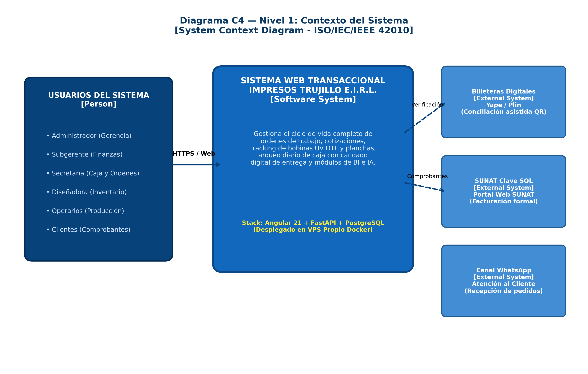

Fuente: diagrama original preservado como antecedente conceptual; no acredita integraciones o accesos externos implementados.

#### Figura 10. Contenedores en el diseño del informe inicial

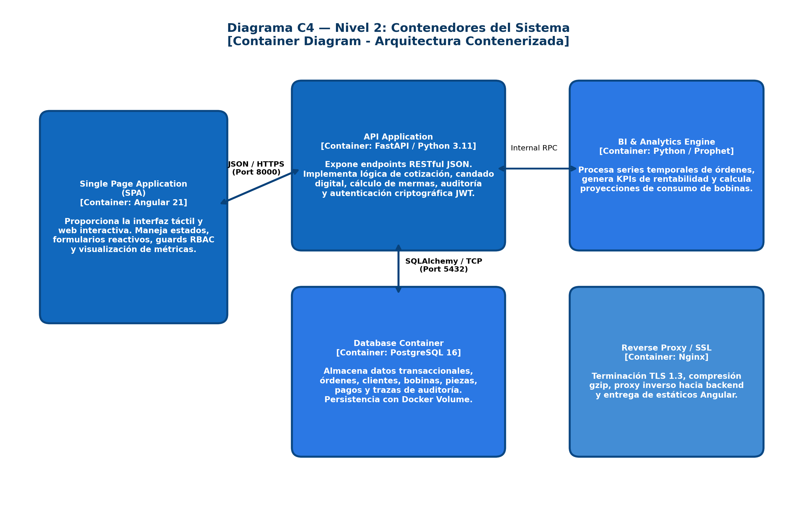

Fuente: diagrama original preservado. Las versiones y el componente predictivo representados pertenecen a ese diseño inicial; la arquitectura actual se presenta en las figuras 14 y 15.

Las siguientes vistas se recuperan del informe inicial para conservar la continuidad visual de los módulos. Documentan la apariencia de aquella versión; no sustituyen las pruebas de aceptación ni se presentan como capturas nuevas del despliegue actual.

#### Figura 11. Vista de órdenes recuperada del informe inicial

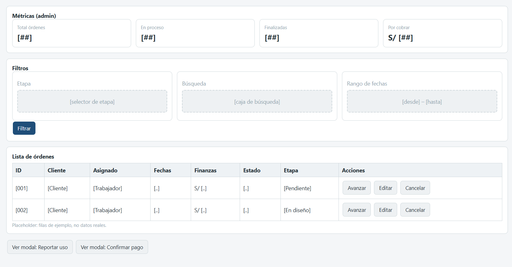

Fuente: captura de interfaz del informe inicial.

#### Figura 12. Vista de auditoría recuperada del informe inicial

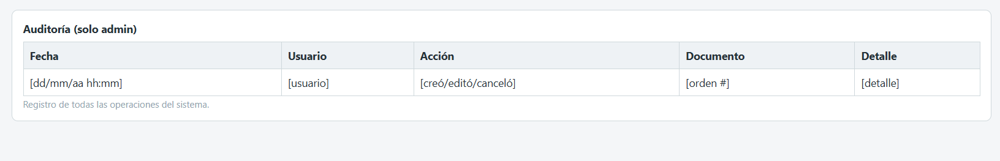

Fuente: captura de interfaz del informe inicial. La imagen corresponde al listado de auditoría visible, no a un arqueo físico de caja.

#### Figura 13. Vista de inventario recuperada del informe inicial

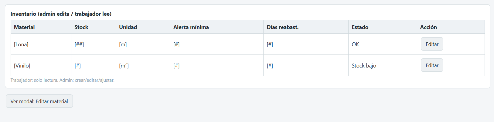

Fuente: captura de interfaz del informe inicial.

#### Figura 14. Arquitectura lógica de la alternativa seleccionada

```text
Usuarios de oficina, taller y administración
                    |
Interfaz web Angular 21
Formularios, consultas, estados y vistas analíticas
                    | Solicitudes y respuestas de la API
API FastAPI / Python 3.13
Autenticación y permisos -> validación -> reglas del negocio
Clientes | órdenes | pagos y caja | producción | inventario
                    |
Acceso a datos SQLAlchemy y esquema versionado con Alembic
                    |
PostgreSQL 17 <----> referencias a documentos adjuntos persistentes
                    |
Datos operativos -> consultas y agregados BI
```

La previsión de pedidos se mantiene como componente previsto del alcance y se incorpora al diseño sin atribuirle resultados en este avance.

#### Figura 15. Infraestructura tecnológica de la solución

```text
Computadora o celular con navegador
                  |
             Internet / HTTPS
                  |
VPS particular propio
  Proxy de entrada Traefik y terminación TLS
                  |
  Contenedor web: Nginx sirve Angular y reenvía /api
                  |
  Red interna de la aplicación
       |                         |
  Contenedor API --------> Contenedor PostgreSQL
       |                         |
  Archivos persistentes     Datos persistentes
```

El navegador utiliza el punto de entrada web; la configuración de producción no publica directamente los puertos de la API y PostgreSQL. Esta distribución separa el acceso externo de las comunicaciones internas. Los diagramas representan bloques funcionales e infraestructura, sin emplear notación UML.

<!-- REVISIÓN 5.5: arquitectura contrastada con manifests, frontend/nginx.conf y docs/despliegue/vps/docker-compose.yml. No trasladar Tailwind, PostgreSQL 16, Python 3.11, servidor instalado en el taller o servicio IA entrenado desde el informe anterior. El repositorio define persistencia local de adjuntos para el despliegue descrito; no se presupone cifrado de base de datos ni respaldo automatizado por existir volúmenes. -->

### 5.6. Business Case

El caso de negocio fundamenta la inversión en la necesidad de relacionar pedidos, pagos y estados de trabajo y disponer de información para la gestión. La alternativa a medida aprovecha las estaciones de la empresa y concentra los registros en un sistema accesible por navegador. Su justificación comprende la adecuación al proceso, el control de los datos y la posibilidad de verificar los beneficios con indicadores definidos.

Los beneficios esperados son menor tiempo de registro, mejor consulta de saldos, conciliación de caja y disponibilidad de información para planificar el trabajo. El pronóstico se orienta a pedidos; el crédito autorizado forma parte de la operación comercial. La viabilidad técnica se apoya en la arquitectura y los recursos descritos en el capítulo IV, mientras que la viabilidad operativa requiere participación de usuarios e inducción.

Para el informe se adopta el presupuesto de planificación de **S/5,100**, compuesto por **S/4,800 de trabajo valorizado**, **S/180 de servicios tecnológicos** y **S/120 de consumibles y actividades de campo**. Se selecciona esta distribución por su correspondencia con el Acta de Constitución y su consistencia aritmética. El importe representa recursos previstos, no gasto ejecutado ni ahorro obtenido. La evaluación financiera requiere costos y beneficios comprobables; no se calculan retorno de inversión, recuperación, VAN o TIR del proyecto a partir de reducciones no medidas.

### 5.7. Cronograma del proyecto y EDT del proyecto

La EDT organiza el alcance en cinco fases y distingue paquetes de trabajo, actividades y entregables. Para el informe se adopta una programación consolidada que inicia el **22/08/2026**, mantiene el desarrollo incremental y contempla comprobaciones e implantación en paralelo con la construcción. El cronograma expresa planificación; las fechas reales de una integración, prueba o despliegue conservan sus evidencias originales.

La figura 16 se conserva para mantener el antecedente gráfico de la EDT incluida en el informe inicial. Su estructura de ocho fases no se utiliza como codificación vigente: este informe adopta la organización consolidada en cinco fases que se muestra en la tabla 13.

#### Figura 16. EDT del informe inicial conservada como antecedente

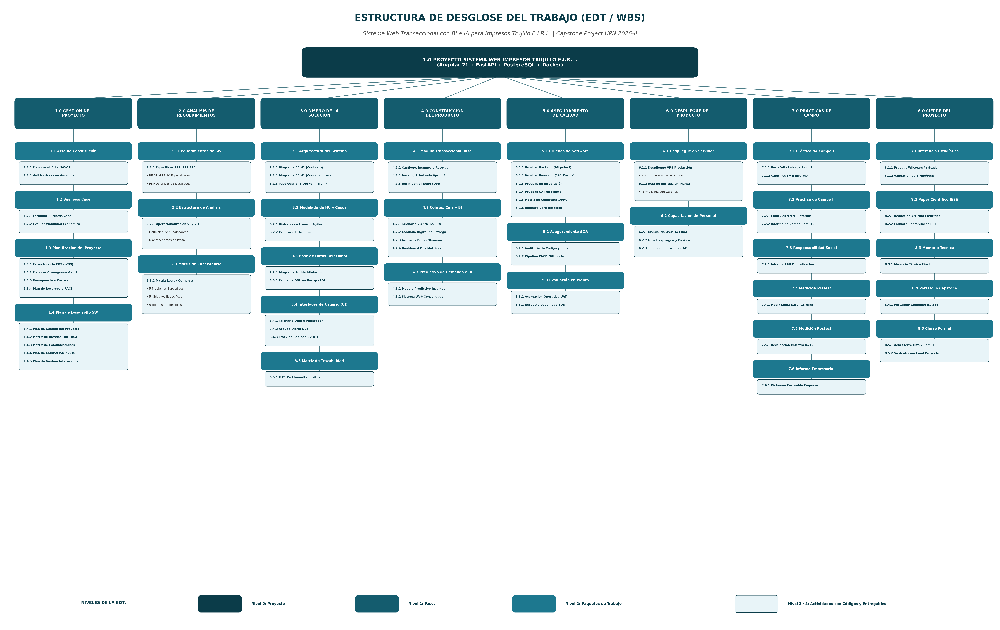

Fuente: gráfico original. Para alcance y programación actual se utiliza la tabla 13; no se suman ni mezclan ambas estructuras.

##### Tabla 13. Programación consolidada de las fases del proyecto

| Código EDT | Fase | Inicio planificado | Fin planificado | Productos principales |
|:---|:---|:---:|:---:|:---|
| 1 | Gestión y Planificación del Proyecto | 22/08/2026 | 11/09/2026 | Documentos de inicio, requisitos y planes de gestión. |
| 2 | Diseño de Ingeniería y Arquitectura | 14/09/2026 | 25/09/2026 | Modelo de datos, contratos de API y diseño de interfaz. |
| 3 | Construcción del Módulo Transaccional | 28/09/2026 | 16/10/2026 | Clientes, catálogo, órdenes, caja, insumos y seguimiento de taller. |
| 4 | Componentes analíticos y previsión de pedidos | 19/10/2026 | 06/11/2026 | Consultas y vistas de BI, organización del historial y preparación del componente predictivo previsto. |
| 5 | Pruebas, Implantación, Capacitación y Cierre | 19/10/2026 | 04/12/2026 | Comprobaciones incrementales, publicación de versiones, capacitación y preparación de la entrega integral. |

Las pruebas y publicaciones de incrementos no esperan a la culminación de todos los componentes: por ello la fase de verificación e implantación se superpone con el desarrollo analítico. La entrega académica se mantiene como hito del **05/12/2026**; el trabajo de cierre se programa hasta el **04/12/2026**, sin asignar horas de desarrollo al sábado de entrega. El servicio y sus registros técnicos acreditan operaciones concretas, no aceptación final de todo el alcance.

La secuencia de trabajo establece requisitos antes del diseño correspondiente, reglas y datos antes de probarlas y verificación técnica antes de publicar cada versión. Las actividades de capacitación y aceptación se coordinan con la disponibilidad de los usuarios. La observación inicial de un indicador debe preceder a la intervención evaluada o disponer de un registro anterior válido; la revisión de documentos de agosto y septiembre no permite reconstruir tiempos de atención ausentes. La consolidación detallada de dependencias debe conservar esta secuencia y distinguir las tareas comunes de las específicas de cada incremento.

<!-- REVISIÓN 5.7: programación consolidada adoptada para el informe por indicación del usuario, no ejecución retrofechada ni acta de aprobación empresarial. Se corrige inicio a 22/08 y se presenta verificación/implantación incremental desde 19/10, compatible con la publicación acreditada del 23/10. El cierre laborable pasa a 04/12 y el hito académico permanece 05/12. Las fuentes semanales no se modifican; sus predecesoras incompatibles y el nombre de reabastecimiento de 4.2.3.1 requieren sincronización posterior. La ventana agosto–septiembre de la muestra es propuesta y debe cotejarse con los talonarios, no acredita mediciones aplicadas. -->

### 5.8. Plan de Gestión de Riesgos

**5.8.1. Roles y Responsabilidades**

- **Gerardo Erick Plasencia Torres — coordinación y arquitectura:** integra el seguimiento de riesgos, coordina decisiones técnicas y administra las respuestas relacionadas con infraestructura y accesos.
- **Jose Estibb Anhuaman Delgado — interfaz y calidad:** registra incidencias de uso, organiza casos de aceptación y apoya la inducción y las comprobaciones de interfaz.
- **Jose Diego Rodriguez Vasquez — backend, datos e IA:** revisa integridad de datos, reglas de cálculo, evolución del esquema y suficiencia de la serie para el pronóstico.
- **Marcell Magaly Vásquez Loje — administración y reglas comerciales:** confirma criterios de cobro, crédito y conciliación, y participa en las decisiones que afectan la operación de oficina.
- **Angel Almilcar Rodríguez Evangelista — producción:** contrasta especificaciones de trabajo, materiales y continuidad del taller.
- **Personal de oficina y taller:** comunica incidencias y participa en los escenarios que corresponden a sus funciones.

Cada riesgo tiene un responsable de seguimiento. Las decisiones que modifican presupuesto o alcance requieren identificar al responsable de autorización y registrar la decisión; asignar actividades no constituye evidencia de aprobación o ejecución.

**5.8.2. Presupuesto**

El costo de las respuestas se registra por actividad y naturaleza del recurso: esfuerzo valorizado, servicios o consumibles. Las actividades de limpieza de datos, pruebas e inducción se vinculan a sus paquetes de trabajo para evitar contabilizarlas dos veces. Las respuestas que requieran gastos adicionales deben identificar importe, fuente de financiamiento y autorización antes de incorporarse al presupuesto de referencia de 5.10. No se incorpora una reserva porcentual como efectivo disponible sin identificar su financiamiento.

<!-- REVISIÓN 5.8.2: el informe previo proponía 10% = S/510 sobre S/5,100, pero no se ha acreditado un fondo financiado ni su inclusión en el total. No sumar ni declarar aprobada esa reserva por inferencia. -->

**5.8.3. Matriz de riegos**

La matriz conserva la identificación de los siete riesgos del plan inicial y ajusta su tratamiento al alcance de pedidos. Las valoraciones cualitativas proceden de dicho plan y funcionan como referencia para su revisión, no como probabilidades medidas. El seguimiento registra señal de alerta, respuesta acordada, evidencia y riesgo residual después de cada revisión relevante del producto.

##### Tabla 14. Matriz de riesgos y respuestas previstas

| Riesgo | Relación con EDT | Señal y consecuencia | Probabilidad / impacto de referencia | Respuesta prevista | Responsable de seguimiento |
|:---|:---|:---|:---|:---|:---|
| R1. Datos históricos incompletos o tardíos | 4.2.1; 5.4 | Faltan fechas, identificadores o documentos; se limita la comparación y la serie de pedidos. | Media / medio | Inventariar documentos recibidos, cotejar transcripciones y registrar cobertura y exclusiones. | Jose Diego Rodriguez Vasquez. |
| R2. Dificultad de adopción del registro digital | 2.3; 5.3 | Persisten registros paralelos o tareas no comprendidas; se pierde trazabilidad. | Alta / medio | Revisar pantallas con usuarios, preparar ejemplos e inducción según funciones. | Jose Estibb Anhuaman Delgado, con administración y taller. |
| R3. Interrupción eléctrica en el local | 5.2 | Se detiene el acceso desde las estaciones y quedan operaciones sin confirmar. | Media / alto | Distinguir operaciones confirmadas, acordar registro de contingencia y reconciliar al restablecer el servicio. | Gerardo Erick Plasencia Torres, con la empresa. |
| R4. Diferencias en precios y parámetros de materiales | 3.1.2; 3.4 | Cotizaciones o consumos difieren de las reglas comerciales y productivas. | Media / medio | Contrastar parámetros con responsables, registrar cambios y probar cálculos antes de publicarlos. | Jose Diego Rodriguez Vasquez, con administración y producción. |
| R5. Comprobante de pago incorrecto o duplicado | 3.3 | Un adjunto no coincide con la operación financiera; se registra un cobro sin sustento. | Baja / alto | Verificar referencia, importe y medio de pago; distinguir pago conforme y observado y documentar crédito autorizado. | Marcell Magaly Vásquez Loje; soporte técnico de Gerardo Erick Plasencia Torres. |
| R6. Caída de conectividad o del servicio | 5.2 | La oficina y el taller no pueden consultar o registrar operaciones. | Baja / medio | Identificar incidencia, aplicar registro de contingencia y cotejar operaciones al recuperar el servicio, evitando duplicados. | Gerardo Erick Plasencia Torres. |
| R7. Serie insuficiente o inconsistente para el pronóstico | 4.2 | Hay pocos períodos, huecos o cambios de registro; el modelo no mejora la referencia. | Media / medio | Revisar cobertura temporal, separar entrenamiento y prueba y comparar MAE sobre los mismos días; ampliar la serie cuando corresponda. | Jose Diego Rodriguez Vasquez. |

<!-- La plantilla original titula 5.8.3 «Matriz de riegos»; se conserva su texto. Respuestas como autosalvado local, UPS, respaldos programados o precisión del 70% no se afirman ejecutadas. La matriz es una propuesta actualizada para este informe y no modifica las fuentes de gestión. -->

### 5.9. Plan de Gestión de Interesados

**5.9.1. Registro de interesados**

El registro distingue a quienes autorizan reglas y acceso, quienes utilizan el sistema, quienes construyen la solución y quienes evalúan el trabajo académico. Los clientes comerciales son afectados por el proceso de atención, pero no se presume que tengan una cuenta o acceso directo a la aplicación.

##### Tabla 15. Registro de interesados y participación prevista

| Interesado | Relación con el proyecto | Necesidad o expectativa | Mecanismo de participación |
|:---|:---|:---|:---|
| Angel Almilcar Rodríguez Evangelista | Propietario y referente de producción. | Especificaciones y seguimiento del trabajo de taller. | Revisión de escenarios productivos y decisiones sobre reglas de su ámbito. |
| Marcell Magaly Vásquez Loje | Propietaria y referente de administración. | Consulta de pedidos, pagos, saldos y crédito autorizado. | Priorización y revisión de escenarios comerciales y de caja. |
| Personal de oficina | Usuario del registro comercial y de cobros, según permisos. | Formularios comprensibles y datos consultables durante la atención. | Pruebas de tareas e incidencias e inducción. |
| Personal de taller | Usuario del seguimiento productivo, según permisos. | Especificaciones claras y actualización de estados y materiales. | Revisión del flujo y escenarios de producción. |
| Gerardo Erick Plasencia Torres | Líder y desarrollador Full Stack. | Coherencia de alcance, arquitectura e integración. | Coordinación, seguimiento de acuerdos e integración técnica. |
| Jose Estibb Anhuaman Delgado | Desarrollador Frontend. | Interfaz consistente y criterios verificables de interacción. | Diseño de pantallas, pruebas y registro de incidencias. |
| Jose Diego Rodriguez Vasquez | Desarrollador Backend e IA. | Reglas de negocio y datos consistentes para análisis y pronóstico. | Desarrollo de servicios, controles de datos y evaluación predictiva. |
| Clientes comerciales | Beneficiarios indirectos del proceso de atención. | Registro correcto de especificaciones, pagos y condiciones de entrega. | Observaciones canalizadas por la empresa; datos anonimizados en el estudio. |
| Docente del curso | Asesor y evaluador académico externo al equipo ejecutor. | Informe y evidencias consistentes con la consigna. | Observaciones académicas y revisión de entregables. |

<!-- REVISIÓN 5.9.1: se corrige el nombre heredado «Ángel Rodríguez Rodríguez» usando el Contexto del Negocio y la RACI. No incorporar «Manuel», cargos específicos de operarios ni posturas favorable/neutral sin confirmación. La función del docente se mantiene fuera de las responsabilidades ejecutoras del sistema. -->

**5.9.2. Alcance e impacto del proyecto sobre los interesados**

Para administración, el cambio principal es relacionar las condiciones comerciales, pagos y saldos de una orden. Para taller, consiste en consultar especificaciones y compartir el estado del trabajo. Para los propietarios, supone disponer de información consolidada y asumir decisiones sobre permisos, crédito y continuidad del servicio. Para el equipo, implica construir y mantener el producto y documentar sus comprobaciones. El cliente comercial recibe el efecto del proceso de atención, sin que ello implique incorporar un portal de clientes al alcance.

La participación se organiza mediante revisión de incrementos, sesiones de comprobación de tareas e inducción y un registro de incidencias y acuerdos. Cada observación debe identificar la necesidad, su prioridad, la decisión adoptada y el criterio para verificarla. Los cambios de alcance, costo o fecha se comunican a los interesados afectados antes de actualizar los documentos de referencia. Las expectativas y el grado de adopción se contrastan mediante participación real, sin asignar posturas por inferencia.

### 5.10. Presupuesto del proyecto

El presupuesto adoptado para este informe es de **S/5,100**, tomando la distribución por categorías del Acta de Constitución. Se distinguen recursos valorizados y desembolsos previstos. La reutilización de equipos se registra sin compra adicional y no se vuelve a sumar como adquisición o alquiler sin una partida sustentada. La base seleccionada es de planificación y no constituye un registro de gasto ejecutado.

##### Tabla 16. Presupuesto de planificación adoptado por naturaleza del recurso

| Concepto | Naturaleza | Importe planificado (S/) | Tratamiento |
|:---|:---|---:|:---|
| Esfuerzo de desarrollo del equipo | Valorización | 4,800.00 | Estimación de 240 horas a S/20 por hora; no equivale a horas ejecutadas o a honorarios pagados. |
| Servicios tecnológicos: VPS y dominio | Desembolso previsto | 180.00 | Verificar distribución y comprobantes antes de reportar gasto real. |
| Consumibles, documentación y traslados | Desembolso previsto | 120.00 | Registrar gastos y evitar duplicarlos en otras partidas. |
| Equipos e infraestructura existentes | Reutilización sin adquisición adicional | 0.00 | No representa ausencia de consumo, mantenimiento o valor del recurso. |
| **Subtotal de desembolsos previstos** | **Parte del total** | **300.00** | **180.00 + 120.00; no se suma nuevamente al total.** |
| **Total de referencia** | **Valorización + desembolsos** | **5,100.00** | **4,800.00 + 300.00.** |

El control económico utiliza esta distribución como base del informe y registra por separado los gastos efectivamente sustentados. La valorización del esfuerzo no se vuelve a sumar como desembolso y los subtotales no se adicionan nuevamente al total. El detalle por paquetes debe distribuir los mismos recursos dentro del límite adoptado, sin incorporar amortizaciones, horas o servicios duplicados. Cualquier modificación requiere identificar su causa, financiamiento y efecto en el total. Los indicadores de gasto real o desempeño financiero se calculan únicamente con registros de ejecución.

<!-- DECISIÓN 5.10: por indicación del usuario se selecciona la base del Acta S/5,100 = 4,800 valorizado + 180 + 120 efectivo previsto. Comprobación independiente: las 19 filas del costeo alternativo suman 4,800 RRHH + 740 equipos + 400 consumibles = 5,940; tampoco concuerdan con sus columnas totales declaradas 670/380, y el subtotal de cierre difiere de sus filas. Se descarta ese desglose como base del informe, no se convierte 5,940 en gasto real ni se elimina una factura comprobada. Las fuentes anteriores no quedan corregidas por esta selección y deberán sincronizarse si se entregan como anexos. -->

### 5.11. Plan de seguridad

El plan protege las cuentas de acceso, los datos de clientes, las órdenes, los pagos, los documentos adjuntos y la disponibilidad del servicio. Los permisos se conceden según la función y deben verificarse en el servidor, incluso cuando la interfaz oculta opciones no autorizadas.

- **Identidad y sesión:** el código de seguridad utiliza hash bcrypt para contraseñas y tokens firmados con expiración y versión de sesión. El navegador dispone de una vía de sesión mediante cookie HttpOnly. Se comprueban rechazo de sesiones expiradas o revocadas y restricciones de cuentas desactivadas. El hash de una contraseña no es cifrado de todos los datos del sistema.
- **Autorización:** los roles y las reglas sobre cada operación determinan quién registra, consulta, modifica o autoriza. Las pruebas deben incluir accesos permitidos y denegados y evitar que un cambio en el navegador eluda la validación del backend.
- **Integridad y trazabilidad:** los cambios comerciales sensibles, pagos y autorizaciones de crédito deben conservar actor, fecha y referencia de operación. Se verifican cálculos, relaciones y tratamiento de errores para evitar saldos o registros inconsistentes.
- **Comunicaciones e infraestructura:** el punto de entrada utiliza HTTPS y la configuración del despliegue mantiene API y base de datos en la red interna. Las credenciales y claves operativas se gestionan fuera de las evidencias públicas del proyecto y se limitan los accesos de administración.
- **Archivos y evidencias:** se restringe el acceso a documentos adjuntos y se comprueban sus tipos, tamaño y asociación con una operación. Las evidencias de investigación excluyen nombres, contactos y referencias bancarias que no sean necesarios para la evaluación.
- **Continuidad:** se define el procedimiento de copia, ubicación, retención y restauración de datos y documentos, con responsable y registro de prueba de recuperación. Ante indisponibilidad se utiliza el procedimiento de contingencia y reconciliación, sin asumir sincronización automática ni funcionamiento fuera de línea.
- **Incidentes:** se registra el evento, alcance, medidas de contención, recuperación y revisión de accesos. Las decisiones sobre datos personales se coordinan con la empresa según las obligaciones aplicables.

La verificación conserva versión del sistema, entorno, fecha, caso y resultado. Los controles observados en el código o la configuración se distinguen de su comprobación en ejecución. Un plan de respaldo solo se considera ejecutado cuando existen copias y una prueba documentada de restauración.

<!-- REVISIÓN 5.11: autenticación y roles contrastados con backend/app/core/security.py; red y HTTPS con la configuración de producción. No declarar pruebas de penetración, respaldo automático diario, cero vulnerabilidades, cifrado de todos los datos o cumplimiento legal integral sin evidencia. El informe presenta procedimientos de verificación, no nuevos resultados de pruebas ejecutadas en esta revisión. -->

### 5.12. Plan de Calidad de software

El plan toma como referencia ISO/IEC 25010:2023, de acuerdo con el capítulo IV, y vincula requisitos, características de calidad y casos de comprobación. Cada ejecución debe conservar versión del producto, datos de prueba, entorno, resultado esperado, resultado observado e incidencias. Los criterios siguientes constituyen una propuesta de aceptación que se concreta por caso y no una declaración de resultados alcanzados.

##### Tabla 17. Métricas de calidad y método de verificación

| Característica o aspecto | Métrica o criterio propuesto | Objetivo propuesto | Método de verificación | Evidencia a conservar |
|:---|:---|:---|:---|:---|
| Adecuación funcional | Casos críticos conformes / casos críticos especificados × 100. | 100% de los casos críticos del alcance evaluado conformes antes de su aceptación. | Escenarios de órdenes, pagos, crédito, caja y permisos con resultados esperados. | Matriz requisito–caso y reporte por versión. |
| Corrección funcional | Diferencias entre cálculo obtenido y cálculo de referencia. | Coincidencia con reglas y redondeo definidos; sin diferencias superiores a S/0.01 en los cotejos monetarios. | Pruebas de importes, adelantos, pagos conformes, saldos y cancelaciones. | Entradas, cálculo independiente y resultado de la aplicación. |
| Seguridad | Accesos indebidos permitidos en los casos de prueba. | Ningún acceso indebido permitido dentro de los escenarios especificados. | Pruebas de autenticación, rol, propiedad de registros y revocación de sesión. | Casos permitidos/denegados y respuestas observadas. |
| Fiabilidad e integridad | Operaciones confirmadas conservadas y duplicados en escenarios de fallo. | Conservar las operaciones confirmadas sin duplicación en los escenarios evaluados. | Pruebas de error, interrupción, reintento y consulta posterior. | Estado anterior/posterior y registro de incidencias. |
| Capacidad de interacción | Tareas completadas, errores de uso y observaciones por tarea. | Completar las tareas críticas sin incidencias bloqueantes en los escenarios acordados. | Pruebas con usuarios de oficina y taller; SUS solo si se aplica la versión definida. | Guion, observaciones y registros anonimizados. |
| Eficiencia de desempeño | Percentiles de tiempo de respuesta y tasa de errores bajo carga definida. | Acordar umbrales por operación y concurrencia antes de ejecutar la prueba. | Medición con conjunto de datos, entorno y carga identificados. | Configuración, muestras de respuesta y reporte; sin adoptar 250 ms como resultado o umbral validado. |
| Mantenibilidad | Trazabilidad del cambio y comprobaciones de regresión. | Cambio vinculado a requisito o incidencia y comprobaciones pertinentes satisfactorias. | Revisión de diferencias, esquema versionado y pruebas de regresión. | Versión, revisión y resultados de pruebas. |
| Componente de IA previsto | Criterio de evaluación de previsión de pedidos. | Establecer y aplicar su evaluación en la etapa correspondiente. | Procedimiento posterior conforme al capítulo III. | Evidencia de evaluación cuando corresponda; sin resultados predictivos en este avance. |

El cierre de una incidencia requiere comprobar su corrección y revisar las funciones relacionadas. Las pruebas automatizadas aportan evidencia técnica, mientras que la aceptación de las tareas de negocio requiere escenarios revisados con los usuarios correspondientes. Los resultados de calidad se presentan en el capítulo de metodología con sus reportes, sin reemplazarlos por metas del plan.

<!-- REVISIÓN 5.12: se retiran como hechos los valores heredados de cobertura, latencia, capacitación y resiliencia sin reportes. MAE es una medida del componente predictivo, no una característica adicional de ISO/IEC 25010 ni una prueba de validez de instrumentos. Los títulos 5.3/5.8/5.9 se ajustan a la jerarquía y texto de la plantilla. Se utilizan sufijos 14-A/B/C para no renumerar las tablas de VI durante esta revisión exclusiva de V. -->

## VI. METODOLOGÍA DE DESARROLLO A UTILIZAR

### 6.1. Desarrollo de la metodología

El desarrollo toma Scrum como marco de referencia, conforme a la selección justificada en el capítulo IV. El trabajo se organiza mediante un backlog de necesidades, selección de objetivos de incremento, construcción y comprobación del producto y revisión de las observaciones recibidas. Esta organización permite precisar reglas de pedidos, pagos, crédito y producción sin tratar la planificación inicial como una descripción inmutable del negocio.

El equipo integra las funciones de coordinación, desarrollo de interfaz, backend, datos y calidad. La administración de la empresa participa en las reglas comerciales y de caja; la referencia de producción participa en especificaciones y seguimiento de taller. La planificación de cada incremento debe identificar su objetivo, los elementos seleccionados, sus criterios de aceptación y las comprobaciones necesarias. La definición de terminado contempla código integrado, pruebas pertinentes y evidencia del comportamiento esperado; la aceptación de una tarea de negocio se documenta con el usuario correspondiente.

La ejecución se presenta mediante etapas de ingeniería que se revisan dentro del desarrollo incremental: planificación, análisis, diseño, construcción y verificación. Estas etapas no representan una sustitución de Scrum por un proceso secuencial; permiten describir los productos y las evidencias de cada actividad.

##### Tabla 18. Etapas de metodología, actividades, productos y evidencia

| Etapa | Actividades | Producto o resultado de ingeniería | Evidencia disponible |
|:---|:---|:---|:---|
| Planificación | Delimitar alcance, recursos, responsabilidades, riesgos y necesidades priorizadas. | Acta, caso de negocio, Plan de Desarrollo de Software, EDT, cronograma y backlog. | Documentos de planificación conservados por el proyecto; su existencia no acredita por sí sola aceptación o ejecución. |
| Análisis | Relacionar el registro comercial con producción, pagos y consulta de información. | Requisitos funcionales, reglas de negocio y criterios por escenario. | Especificación de requisitos, notas de relevamiento y ajustes del alcance descritos en los capítulos III y V. |
| Diseño | Separar presentación, servicios, reglas y persistencia; definir el acceso según funciones. | Componentes de interfaz, contratos de API, modelo relacional y configuración de servicios. | Código y configuración de Angular, FastAPI, PostgreSQL y Docker; diagramas actuales de las figuras 14 y 15. |
| Construcción incremental | Integrar funciones transaccionales, consultas y vistas de gestión. | Código de clientes, órdenes, cobros, caja, producción, inventario y BI. | Historial del repositorio; el commit d99788f incorpora el panel BI y 8b5c8f4 organiza la navegación y las acciones de interfaz. |
| Verificación técnica | Ejecutar pruebas automatizadas, migraciones, compilación y comprobaciones de imágenes y configuración. | Resultados reproducibles ligados a una versión del código. | Ejecución CI-01 del commit 8b5c8f4, con pruebas backend/frontend y verificaciones de construcción satisfactorias. |
| Despliegue y comprobación operativa inicial | Publicar una versión identificada y comprobar sus puntos de entrada. | Servicios accesibles y registro de la versión desplegada. | Job de despliegue y comprobaciones HTTP de CI-01, descritos en 6.3. |

La programación del informe corresponde a las fases y fechas consolidadas de la tabla 13: planificación, diseño, construcción transaccional, componentes analíticos y verificación y cierre incremental. Los objetivos de incremento se relacionan con sus códigos de EDT y dependencias. Las fechas reales se respaldan con registros propios; los indicadores de cumplimiento temporal requieren además la programación detallada y el control de ejecución.

La trazabilidad del producto relaciona necesidad, requisito, criterio, versión y comprobación. Los registros de desarrollo y las ejecuciones automáticas permiten identificar cambios y resultados técnicos; las reuniones, horas de trabajo y decisiones de aceptación requieren sus propios registros. El componente de IA permanece en el alcance previsto y sus resultados se incorporarán cuando exista una evaluación específica.

<!-- REVISIÓN 6.1: fuentes documentales PDS, backlog, EDT y cronograma, mantenidas en solo lectura. No declarar realizados cuatro Sprints quincenales, reuniones diarias, horas o aceptaciones basándose únicamente en cronogramas o diarios no cotejados. HU-04 y HU-10 heredadas requieren formalizar posteriormente los ajustes de crédito autorizado y pronóstico de pedidos en las fuentes; no se trasladan reglas antiguas al informe. CI-01 corresponde a 40059904772, no al run histórico 38028670036. -->

### 6.2. Pruebas de Calidad

Las pruebas se organizan según el nivel y el propósito de la comprobación. Las unitarias verifican una regla o componente aislado; las de integración comprueban la interacción entre servicios, API y persistencia; las de interfaz verifican componentes y comportamientos del cliente web; y las de aceptación contrastan tareas de negocio con los usuarios correspondientes. El plan de calidad del capítulo V establece los criterios de referencia bajo ISO/IEC 25010:2023.

La evidencia técnica principal es la **ejecución CI-01**, identificada como [GitHub Actions 40059904772](https://github.com/YamiDarknezz/IMPRESOS-TRUJILLO-E.I.R.L./actions/runs/40059904772), para el commit **8b5c8f4810a70fd368246edce33b485f942070a2**. Se inició el **23/10/2026 en hora de Perú —24/10/2026 UTC—** y concluyó satisfactoriamente en los jobs de backend, frontend y despliegue. Sus logs registran **301 pruebas backend aprobadas** y **473 pruebas frontend aprobadas en 43 archivos**. Estos conteos corresponden a esa ejecución y versión; no son un porcentaje de funcionalidades del sistema.

Los datos de las pruebas automatizadas son controlados por los casos y sus fixtures y se distinguen de los registros comerciales utilizados en el estudio. Cada resultado se interpreta según el entorno en que se obtuvo. Las mediciones de latencia bajo carga, usabilidad con usuarios y recuperación requieren protocolos y reportes específicos; el éxito de la integración continua no reemplaza esas evaluaciones.

**6.2.1. Pruebas unitarias**

El backend utiliza pytest para comprobar validación de entradas, cálculos, restricciones y reglas de las operaciones. Las pruebas aisladas se distinguen de aquellas que crean datos y ejercitan varios servicios. Las fixtures de integración emplean una base SQLite en memoria para determinados escenarios y existe un grupo de comprobaciones específicas sobre PostgreSQL. En integración continua se dispone de PostgreSQL 17 como servicio de pruebas y se ejecutan migraciones antes de la suite.

Por tanto, el resultado de **301 pruebas backend aprobadas** no se presenta como 301 pruebas exclusivamente unitarias: reúne comprobaciones de distintos niveles. Entre los escenarios observables en el código se encuentran pagos y saldos, estados de órdenes, permisos y entregas con saldo autorizado. El caso `test_entrega_con_saldo_autorizada_y_cuentas_por_cobrar_en_postgres` verifica una autorización de entrega, su serialización y la conservación de la cuenta por cobrar. Las pruebas de BI contrastan fechas, separación entre valor de órdenes y cobros y tratamiento de saldos mediante datos controlados.

El frontend ejecuta sus comprobaciones mediante la configuración de pruebas de Angular y Vitest. El resultado de **473 pruebas aprobadas** respalda los casos ejecutados de la interfaz y sus componentes; no demuestra por sí mismo una tarea completa en el navegador con un usuario de la empresa. La cobertura de líneas o ramas tampoco se deduce del número de casos aprobados y debe sustentarse en un reporte de cobertura si se desea informarla.

<!-- REVISIÓN 6.2.1: PPU contiene CA01–CA05 y 257 tests como cifra heredada, pero las fichas no acreditan por sí solas las salidas declaradas. No trasladar seis intentos «OK» por caso, strings de respuesta, sanitización XSS, estados de caja, credenciales de ejemplo o porcentajes de cobertura sin vincularlos a pruebas reales. El comentario del workflow que menciona 96 pruebas también está desactualizado: prevalece el resumen ejecutado de CI-01. -->

**6.2.2. Pruebas de aceptación**

La aceptación se organiza por tareas reconocibles para administración y taller. Cada ficha debe identificar versión, entorno, participante o rol, datos de prueba, pasos, resultado esperado, resultado observado, incidencias y decisión. Una prueba funcional local o automatizada aporta evidencia técnica; la conformidad de negocio requiere registrar la participación y decisión del usuario correspondiente.

La siguiente matriz organiza los escenarios de aceptación y corrige la relación entre los códigos de caso y los requisitos de origen. Las reglas se interpretan con el alcance actualizado de crédito autorizado y predicción de pedidos.

##### Tabla 19. Escenarios y criterios para las pruebas de aceptación

| Caso | Tarea y referencia de requisitos | Comportamiento esperado | Participación y evidencia requerida |
|:---|:---|:---|:---|
| CP-01 | Autenticación y acceso; requisitos de seguridad. | Permitir funciones según permisos y rechazar accesos no autorizados en el servidor. | Usuario de cada rol; pasos, respuestas y observación de la interfaz. |
| CP-02 | Registro y consulta de clientes; RF-01. | Conservar datos válidos y permitir localizar el cliente sin duplicarlo indebidamente. | Personal de oficina; entradas, consulta y registro resultante. |
| CP-03 | Catálogo, emisión y documento interno; RF-02, RF-03 y RF-04. | Generar una orden identificable con importes y especificaciones acordes con el caso. | Oficina y administración; cálculo de referencia y documento obtenido. |
| CP-04 | Pagos y caja; RF-06 y RF-08. | Relacionar cobros con la orden y reflejar importes por medio y línea de negocio. | Administración; pagos, resumen y contraste documental o físico correspondiente. |
| CP-05 | Edición y entrega; RF-05 y regla actualizada de RF-07. | Aplicar restricciones de edición y distinguir entrega liquidada de crédito autorizado, conservando el saldo cuando corresponda. | Administración y taller; permisos, autorización y cuenta por cobrar. |
| CP-06 | Insumos y producción; RF-09 a RF-13. | Comprobar movimientos y estados sobre escenarios específicos, sin equiparar un registro informático con conteo físico o merma medida. | Personal de taller; materiales, transiciones y registros antes/después. |
| CP-07 | Consulta de BI; RF-14. | Mostrar agregados coherentes con registros y filtros del escenario. | Administración; datos de referencia y contraste de resultados. |
| CP-08 | Exportación de reportes; RF-15. | Obtener el archivo especificado y verificar campos, filtros e importes en una aplicación compatible. | Administración; archivo generado y cotejo de su contenido. |
| CP-09, previsto | Previsión de pedidos; alcance actualizado de RF-16. | Comprobar el componente de IA en la etapa correspondiente, según el criterio del capítulo III. | Responsable de datos y usuario de planificación; evidencia de evaluación posterior. |

Los casos de esta matriz constituyen el protocolo de aceptación y no se marcan como aprobados únicamente por aparecer en el plan. La publicación de una versión, el uso de registros comerciales y el éxito de las pruebas automáticas no sustituyen las fichas de aceptación. Las incidencias detectadas deben relacionarse con su corrección y repetición del caso antes de registrar la conformidad.

<!-- REVISIÓN 6.2.2: el PPF heredado atribuye RF-01 tanto a autenticación como a clientes, mezcla IA con CP-07 y declara 100% en todas las filas sin matriz de ejecución respaldada. Se corrige la trazabilidad: RF-01 es clientes; CP-07 corresponde a BI y CP-09 es propuesta adicional para IA de pedidos. RF-07/RF-16 requieren actualización formal en la especificación fuente. No trasladar latencias, aprobaciones o resultados de CP-01–CP-08 sin fichas/capturas verificables ni afirmar que su ejecución local demuestra despliegue. -->

### 6.3. Despliegue

La solución se aloja en un **VPS particular propio** mediante servicios de interfaz web, API y PostgreSQL. La configuración de producción utiliza un punto de entrada HTTPS y mantiene la API y la base de datos en la red interna. Los datos y los documentos adjuntos disponen de almacenamiento persistente, conforme a la infraestructura descrita en la figura 15.

El flujo de publicación está definido en el workflow de integración continua y en el script de despliegue versionado. Para la rama de publicación, el despliegue depende de que concluyan satisfactoriamente las comprobaciones de backend y frontend. El procedimiento identifica el commit a publicar, solicita un respaldo previo, construye la imagen de la API, aplica migraciones y actualiza los servicios. Posteriormente ejecuta comprobaciones HTTP y registra la versión y el resultado. La existencia de este procedimiento se distingue de la evidencia de su ejecución.

En **CI-01**, el job **«Desplegar en el VPS»** terminó satisfactoriamente y el log identificó **8b5c8f48** como versión publicada. Las comprobaciones posteriores registraron:

- **`GET /health` → HTTP 200:** respuesta del punto de comprobación de salud.
- **`GET /` → HTTP 200:** disponibilidad de la entrada de la interfaz web.
- **`GET /api/auth/me` sin sesión → HTTP 401:** respuesta de una ruta protegida ante una solicitud no autenticada.

Estos resultados acreditan la ejecución de publicación y una comprobación operativa inicial de los puntos indicados. No equivalen a aceptación integral, prueba de todas las rutas, medición bajo carga o validación completa de la configuración TLS. La copia previa forma parte del procedimiento; su generación tampoco sustituye una prueba de restauración de datos y documentos.

La comparación entre producción, pruebas y desarrollo conserva la versión de código y la configuración de cada entorno. Las pruebas que crean, editan o cancelan órdenes se realizan con datos controlados en entornos de prueba; las comprobaciones de consistencia de los datos comerciales del capítulo III se efectuaron mediante consultas de solo lectura.

<!-- REVISIÓN 6.3: ejecución primaria verificada por gh run view 40059904772 --json y logs; resumen preservado en .temp/evidencia_ci_40059904772.json. El run del 10/10/2026 38028670036 omitió despliegue y no se usa para acreditarlo. No se ejecutó en esta revisión un despliegue nuevo, rollback, ensayo de fallo ni escritura en producción. El smoke del script usa una conexión local con verificación de certificado desactivada; no presentar sus respuestas como validación de confianza TLS. No describir la reversión de código como restauración automática del esquema o de datos. -->

### 6.4. Resultados de medición de variable independiente

La variable independiente es el sistema web transaccional con componentes de inteligencia de negocios e inteligencia artificial. Su evaluación distingue los resultados técnicos observados de la cobertura funcional definida en los indicadores VI-1 a VI-4. La tabla 20 resume los resultados verificables de una ejecución identificada y las comprobaciones sobre la fuente de datos; cada fila conserva su alcance de interpretación.

##### Tabla 20. Resultados técnicos verificados y alcance de las comprobaciones

| Tipo de comprobación | Componente o caso | Entorno | Resultado observado | Evidencia |
|:---|:---|:---|:---|:---|
| Suite automatizada backend | Reglas, servicios, API y persistencia según casos ejecutados. | Integración continua con servicio PostgreSQL 17. | **301 pruebas aprobadas.** El total reúne distintos niveles de prueba. | CI-01; job Backend, paso Pruebas. |
| Suite automatizada frontend | Casos de componentes y comportamientos de interfaz. | Integración continua de Angular. | **473 pruebas aprobadas en 43 archivos.** | CI-01; job Frontend, paso Pruebas. |
| Evolución del esquema | Migración desde base vacía y ciclo de reversión/reaplicación sobre datos de prueba. | PostgreSQL del entorno CI. | Pasos finalizados satisfactoriamente. | CI-01; pasos de migración del job Backend. |
| Construcción y configuración | Compilación de interfaz, imágenes y validación de configuración Nginx. | Integración continua. | Pasos de construcción y comprobación finalizados satisfactoriamente. | CI-01; jobs Backend y Frontend. |
| Publicación y comprobación inicial | Versión 8b5c8f48 y puntos de entrada del servicio. | VPS de producción. | Despliegue satisfactorio; `/health` 200, `/` 200 y `/api/auth/me` sin sesión 401. | CI-01; job Desplegar en el VPS y log del procedimiento. |
| Integridad aritmética y referencial | Pagos asociados a órdenes y cálculo de saldo en 370 órdenes no canceladas. | Fuente comercial, consulta de solo lectura. | Sin pagos huérfanos ni diferencias de saldo superiores a S/0.01 en las reglas examinadas. | Consultas del 24/10/2026 descritas en 3.10. |
| Reproducibilidad de extracción | Selección técnica de 200 órdenes únicas bajo las mismas condiciones. | Misma instantánea de lectura de la fuente comercial. | Dos extracciones recuperaron el mismo conjunto. | Procedimiento y resultado descritos en 3.10. |

La evidencia **CI-01** puede recuperarse en [la ejecución y sus logs públicos](https://github.com/YamiDarknezz/IMPRESOS-TRUJILLO-E.I.R.L./actions/runs/40059904772). Los resultados están vinculados al commit indicado, por lo que una modificación posterior requiere las comprobaciones que correspondan a su alcance.

Para calcular VI-1, VI-2, VI-3 y VI-4 se requiere relacionar cada función especificada con sus criterios y evidencia de conformidad, evitando duplicarla entre grupos. El número de pruebas no constituye el denominador de funciones: varias pruebas pueden verificar una sola función y un caso puede involucrar varios requisitos. Por ello, los conteos anteriores no se convierten en 100% de cobertura funcional, porcentaje de avance o aceptación total del producto.

Las mediciones de la variable dependiente se interpretan con sus unidades y fuentes del capítulo III. La consistencia de los registros y el despliegue observado no demuestran por sí solos una mejora causal de los procesos. Los resultados técnicos de este avance se concentran en los componentes transaccionales, de consulta y de publicación; no incluyen resultados del componente de IA previsto.

<!-- REVISIÓN 6.4: no hay aún matriz consolidada de funciones/criterios/aceptación que permita cuantificar VI-1 a VI-4 ni evaluación de MAE de un modelo. No trasladar 37.5%, precisión 70%, cobertura 80%, Aiken/Cronbach, tiempos de atención o latencias desde textos sin reportes. Evidencia CI recuperada con .temp/verificar_ci_informe.py; esta revisión documental no ejecuta nuevas suites ni altera código de aplicación. -->
